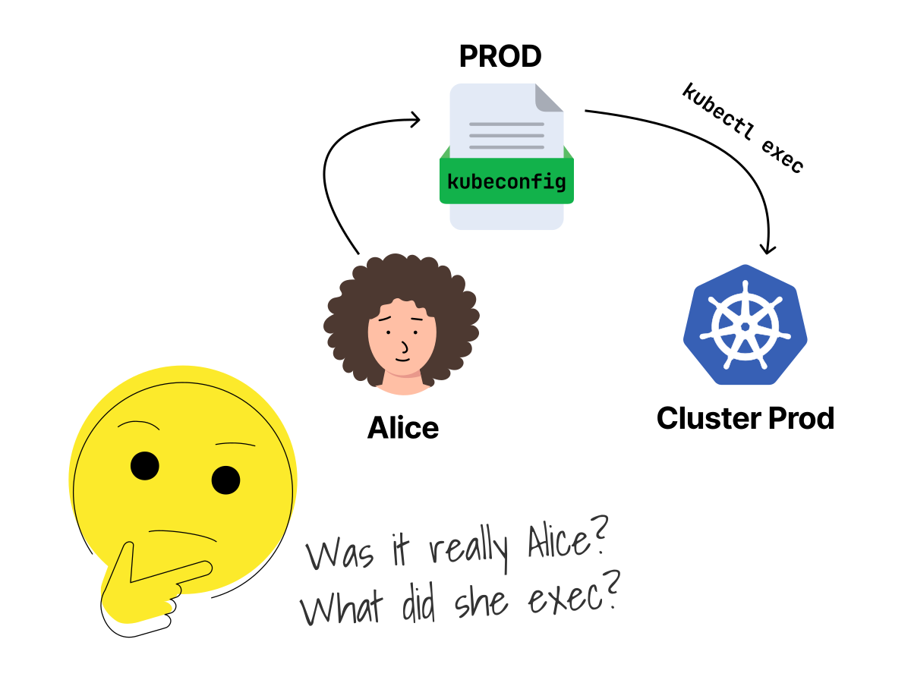
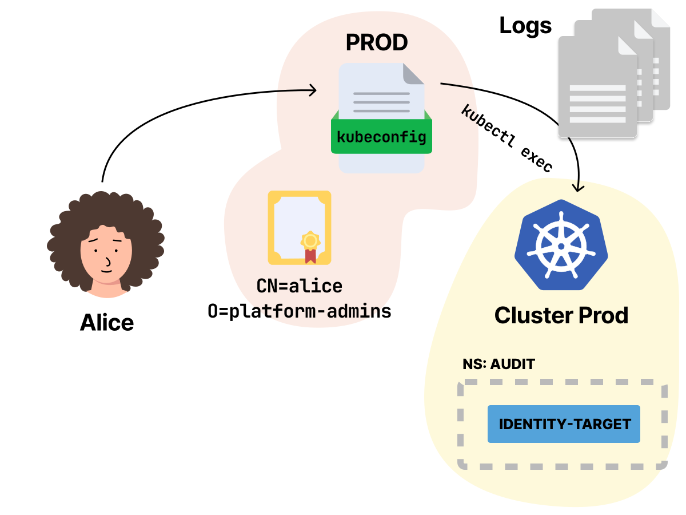
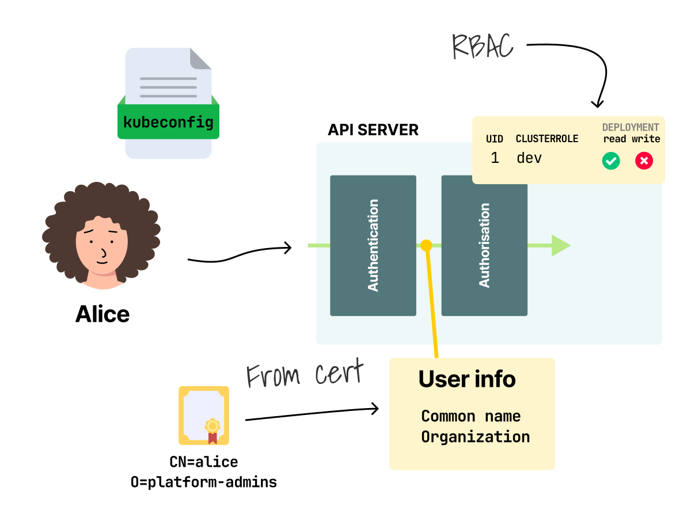
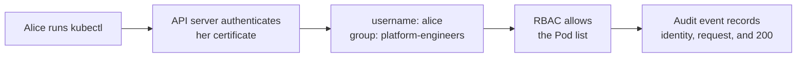
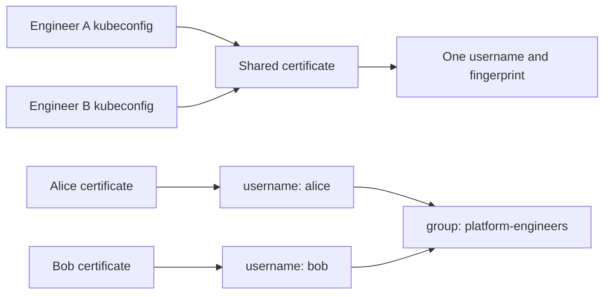
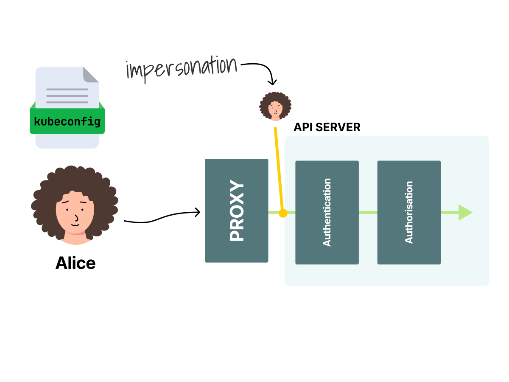
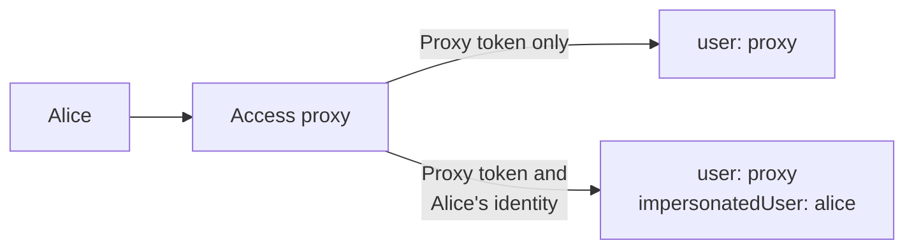
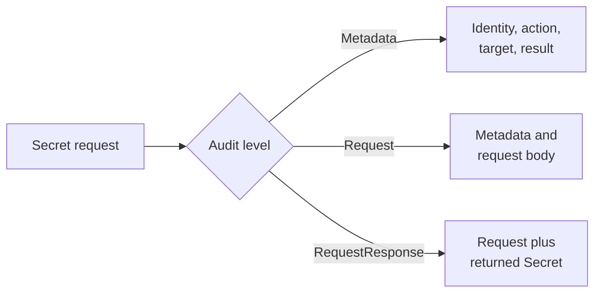
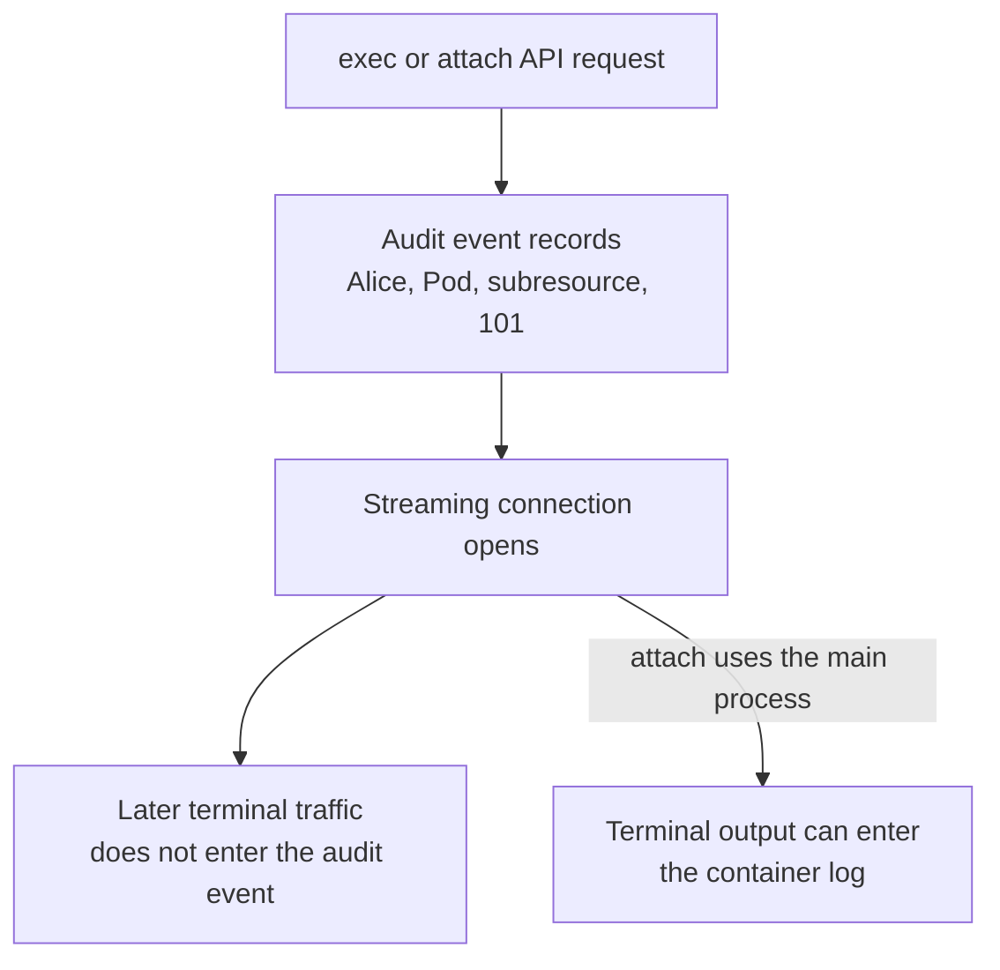

# How to Tie Kubernetes Audit Logs to Individual Engineers

_TL;DR: Kubernetes audit logs may show multiple engineers as one user and do not capture what is typed after a `kubectl exec` session starts. Assign each engineer a unique identity, make sure it stays consistent through proxies and cloud IAM, and use a session recorder if you need to review terminal activity._

- [Audit Logging Is On, but Who Did This?](#audit-logging-is-on-but-who-did-this)
- [The Credential Sets the Attribution Limit](#the-credential-sets-the-attribution-limit)
- [A Proxy Can Replace the Engineer](#a-proxy-can-replace-the-engineer)
- [Cloud IAM Must Preserve the Person](#cloud-iam-must-preserve-the-person)
- [Record Enough Without Copying Secrets](#record-enough-without-copying-secrets)
- [The Audit Log Stops at the Exec Connection](#the-audit-log-stops-at-the-exec-connection)
- [Choose What to Do About Interactive Shells](#choose-what-to-do-about-interactive-shells)
- [Summary](#summary)
- [Connect Identity and Session Records With Teleport](#connect-identity-and-session-records-with-teleport)

## Audit Logging Is On, but Who Did This?

An engineer investigating an incident opens a Kubernetes audit log and finds that someone started an interactive shell in a production Pod.

The event names a user, a namespace, a Pod, and the time when the connection opened.

**At first, the record seems complete, but the engineer still needs to check if only one person used that username and if the log shows anything typed after the shell started.**



The API server sets the username when it checks Alice's credentials, but any commands typed in the shell come after the exec connection is open.

Consider Alice, an engineer with her own [kubeconfig](https://kubernetes.io/docs/concepts/configuration/organize-cluster-access-kubeconfig/).

Her client certificate has this subject:

```text
subject=CN=alice, O=platform-engineers
```

The example cluster contains an `audit` namespace and a Pod named `identity-target`.

When Alice sends a request, the Kubernetes API server [creates an audit event](https://kubernetes.io/docs/tasks/debug/debug-cluster/audit/#auditing) and authenticates her certificate.



This cluster uses the audit log backend, which writes each event as a single JSON line to `/var/log/kubernetes/audit.log`.

When the API server checks a client certificate, it [takes the username from the subject common name and the groups from the organization fields](https://kubernetes.io/docs/reference/access-authn-authz/authentication/#x509-client-certificates).

The [`kubectl auth whoami`](https://kubernetes.io/docs/reference/kubectl/generated/kubectl_auth/kubectl_auth_whoami/) command shows the username, groups, and extra information that the API server accepted:

```bash
kubectl --kubeconfig=/tmp/alice-audit.yaml auth whoami

ATTRIBUTE                                           VALUE
Username                                            alice
Groups                                              [platform-engineers system:authenticated]
Extra: authentication.kubernetes.io/credential-id   [X509SHA256=07228a274806...d2d8a6e0]
```

The `platform-engineers` group comes from the certificate's organization field, while the API server [adds `system:authenticated` after successful authentication](https://kubernetes.io/docs/reference/access-authn-authz/rbac/#default-roles-and-role-bindings).

The `X509SHA256` value is a [SHA-256 fingerprint of the raw client certificate](https://github.com/kubernetes/kubernetes/blob/v1.34.0/staging/src/k8s.io/apiserver/pkg/authentication/request/x509/x509.go).

The fingerprint helps you spot the same certificate in future records, but it does not include the certificate or the private key needed to make a request.

_Does granting access to the group replace Alice with the group name?_

No, because Kubernetes role-based access control (RBAC) [checks the authenticated username and groups](https://kubernetes.io/docs/reference/access-authn-authz/authorization/#request-attributes-used-in-authorization) before allowing the request, which lets the group grant access without replacing Alice's username.



Give the `platform-engineers` group the built-in `view` role with a [ClusterRoleBinding](https://kubernetes.io/docs/reference/access-authn-authz/rbac/#rolebinding-and-clusterrolebinding):

```bash
kubectl create clusterrolebinding platform-engineers-view \
  --clusterrole=view \
  --group=platform-engineers

clusterrolebinding.rbac.authorization.k8s.io/platform-engineers-view created
```

List the Pods as Alice:

```bash
kubectl --kubeconfig=/tmp/alice-audit.yaml get pods

NAME              READY   STATUS    RESTARTS   AGE
identity-target   1/1     Running   0          23s
```

If you inspect `/var/log/kubernetes/audit.log` after Alice lists the Pods, the matching event contains these fields:

```json
{
  "user": {
    "username": "alice",
    "groups": ["platform-engineers", "system:authenticated"],
    "extra": {
      "authentication.kubernetes.io/credential-id": [
        "X509SHA256=07228a274806...d2d8a6e0"
      ]
    }
  },
  "sourceIPs": ["192.168.49.1"],
  "verb": "list",
  "objectRef": {
    "resource": "pods",
    "namespace": "audit"
  },
  "responseStatus": {
    "code": 200
  }
}
```

**The request came in as `alice`, listed Pods in the right namespace, used the recorded source IP, and ended with a `200` response.**

Alice's certificate supplies her identity, while the ClusterRoleBinding grants access through her group.

The audit event then connects that identity to the request and its result:



The audit log still cannot show if someone else used the same certificate and also appeared as `alice`.

_Does the username prove that Alice was the person holding the credential?_

## The Credential Sets the Attribution Limit

Kubernetes [does not store normal human users as API objects](https://kubernetes.io/docs/reference/access-authn-authz/authentication/#users-in-kubernetes).

Before Kubernetes can write a username to the audit event, the API server [checks the certificate or token and turns it into a username, groups, and optional extra fields](https://kubernetes.io/docs/reference/access-authn-authz/authentication/#authentication-strategies).

**If two engineers use the same credential, the API server sees the same identity twice.**

_What does that look like when two kubeconfigs carry the same client certificate?_

Consider a certificate with this subject:

```text
subject=CN=shared-platform-engineer, O=platform-engineers
```

The organization places the shared identity in `platform-engineers`, so the existing ClusterRoleBinding grants it read access.

Two kubeconfigs contain the same certificate and private key:

```yaml
# The relevant user entry in engineer-a.yaml and engineer-b.yaml
users:
  - name: shared-platform-engineer
    user:
      client-certificate-data: <same-certificate>
      client-key-data: <same-private-key>
```

Both kubeconfigs point to the same cluster and namespace.

_Will the two filenames give the audit log two identities?_

Run the same request from both files:

```bash
kubectl --kubeconfig=/tmp/engineer-a.yaml get pods --no-headers

identity-target   1/1   Running   0   105s

kubectl --kubeconfig=/tmp/engineer-b.yaml get pods --no-headers

identity-target   1/1   Running   0   105s
```

The relevant fields from the two recorded events are identical:

```json
[
  {
    "requestReceivedTimestamp": "2026-08-31T20:09:11.074143Z",
    "user": {
      "username": "shared-platform-engineer",
      "extra": {
        "authentication.kubernetes.io/credential-id": [
          "X509SHA256=8c55056f4f13...107b8e24"
        ]
      }
    }
  },
  {
    "requestReceivedTimestamp": "2026-08-31T20:09:11.120040Z",
    "user": {
      "username": "shared-platform-engineer",
      "extra": {
        "authentication.kubernetes.io/credential-id": [
          "X509SHA256=8c55056f4f13...107b8e24"
        ]
      }
    }
  }
]
```

The common name gives the same username, and the matching fingerprint shows both requests used the same certificate.

Neither field can reveal which person held a copy of its private key.

_Does authorizing a group erase the individual username?_

No, because a RoleBinding can [give permissions to a group](https://kubernetes.io/docs/reference/access-authn-authz/rbac/#referring-to-subjects) while authentication keeps each engineer's username.

Alice and Bob have separate client certificates and kubeconfigs:

```text
Alice: subject=CN=alice, O=platform-engineers
Bob:   subject=CN=bob, O=platform-engineers
```

Different common names keep their usernames separate, while the shared organization puts both engineers in `platform-engineers`.

The group binding gives Bob the same `view` permission as Alice, and both engineers can now list the same Pod:

```bash
kubectl --kubeconfig=/tmp/alice-audit.yaml get pods --no-headers

identity-target   1/1   Running   0   3m

kubectl --kubeconfig=/tmp/bob-audit.yaml get pods --no-headers

identity-target   1/1   Running   0   3m
```

The last Pod-list event for each username keeps the person and the shared group:

```json
[
  {
    "user": {
      "username": "alice",
      "groups": ["platform-engineers", "system:authenticated"]
    }
  },
  {
    "user": {
      "username": "bob",
      "groups": ["platform-engineers", "system:authenticated"]
    }
  }
]
```

**Give the `platform-engineers` group the `view` role, but keep `alice` and `bob` as separate usernames.**

The first pair of kubeconfigs shares the same certificate, so both requests produce a single audit identity.

Separate credentials keep Alice and Bob distinct while their group grants the same permission:



Using separate credentials keeps Alice and Bob's actions distinct when they connect directly to the API server.

But many teams route Kubernetes access through a proxy to centralize SSO, access policy, and network entry.

Alice authenticates to the proxy, but the proxy opens a second connection to Kubernetes with its own workload credential.

_Does the Kubernetes audit event record Alice, the proxy, or both?_

## A Proxy Can Replace the Engineer

**When Alice connects directly, her credentials are sent to the Kubernetes API server, and the audit event records her username.**

Once you put a proxy in that path, Alice connects to the proxy, which then opens a separate connection to the API server.

Teams often use a proxy to check company sign-ins, enforce access rules, or give clusters a single, controlled way in.

The API server sees the proxy's connection because that is where the Kubernetes credentials arrive.

If the proxy sends only its own token, Kubernetes authenticates the proxy and writes the proxy's username into the audit event, even though Alice signed in one step earlier.

_Does putting a proxy in front of the cluster always erase Alice from the audit trail?_

No, because [Kubernetes user impersonation](https://kubernetes.io/docs/reference/access-authn-authz/user-impersonation/) gives the proxy a way to pass Alice's identity with the request.



The API server first authenticates the proxy, checks whether it may use Alice's username and group, and then checks Alice's permissions for the requested action.

The proxy uses the `proxy` ServiceAccount in the `audit` namespace.

Allow it to send only Alice's username and the `platform-engineers` group that gives her read access:

```yaml
apiVersion: rbac.authorization.k8s.io/v1
kind: ClusterRole
metadata:
  name: proxy-impersonate
rules:
  - apiGroups: [""]
    resources: ["users"]
    verbs: ["impersonate"]
    resourceNames: ["alice"]
  - apiGroups: [""]
    resources: ["groups"]
    verbs: ["impersonate"]
    resourceNames: ["platform-engineers"]
```

A ClusterRoleBinding assigns this permission to the proxy ServiceAccount.

The two `resourceNames` values stop the proxy from naming another user or group.

They do not restrict the actions that the proxy can take as Alice because [`impersonate` permits every request that Alice can make](https://kubernetes.io/docs/reference/access-authn-authz/user-impersonation/#constrained-impersonation).

Alice can already list Pods through the `platform-engineers` binding from the previous section.

A separate RoleBinding grants the proxy read access under its own identity, allowing us to compare two successful requests.

The proxy first sends its short-lived ServiceAccount token without any information about Alice:

```http
GET /api/v1/namespaces/audit/pods/identity-target
Authorization: Bearer <proxy-ServiceAccount-token>
```

Kubernetes returns `200`, but it authenticates only the proxy.

The proxy then sends the same request with Alice's username and group:

```http
GET /api/v1/namespaces/audit/pods/identity-target
Authorization: Bearer <proxy-ServiceAccount-token>
Impersonate-User: alice
Impersonate-Group: platform-engineers
```

Kubernetes again returns `200`, this time after it checks Alice's permissions as a member of `platform-engineers`.

_Did Kubernetes lose the proxy's identity when it switched to Alice?_

No, and the two audit events make the difference visible.

The relevant fields from the two recorded events show the difference:

```json
[
  {
    "user": {
      "username": "system:serviceaccount:audit:proxy"
    }
  },
  {
    "user": {
      "username": "system:serviceaccount:audit:proxy"
    },
    "impersonatedUser": {
      "username": "alice",
      "groups": ["platform-engineers", "system:authenticated"]
    }
  }
]
```

In an [impersonation audit event](https://kubernetes.io/docs/reference/access-authn-authz/user-impersonation/#auditing), `user` keeps the identity that connected to the API server, while `impersonatedUser` shows the identity whose permissions Kubernetes checked.

The first event contains only the ServiceAccount, while the second connects Alice's action to both Alice and the proxy that carried it.

**The event shows only the proxy unless the request includes Alice's username and group. In that case, the proxy appears under `user` and Alice under `impersonatedUser`.**

You can check any proxy with the same pair of requests, because its sign-in page only proves that the proxy recognized Alice, while the audit events show whether her identity reached Kubernetes.

Without impersonation, Kubernetes knows only the proxy.

With impersonation, the same event keeps the proxy as the connecting identity and Alice as the authorized identity:



_A proxy can send Alice's username to Kubernetes, but what happens when a managed Kubernetes service does that work?_

## Cloud IAM Must Preserve the Person

A proxy is not the only way Alice's name might be lost.

In a managed cluster, Alice signs in to the cloud provider before her request reaches Kubernetes, and the provider chooses the username and groups that Kubernetes receives.

If the provider gives Alice and Bob the same Kubernetes username, the audit log cannot tell which engineer made the request.

The EKS, GKE, and AKS clusters below share the same `audit` namespace and `identity-target` Pod, allowing Alice to make the same harmless Pod request in each cluster.

Start with EKS, where the AWS role session becomes part of Alice's Kubernetes username.

Alice and Bob both get cluster access through an [AWS Identity and Access Management (IAM) role](https://docs.aws.amazon.com/IAM/latest/UserGuide/id_roles.html) named `platform-engineer`.

They use the same role, but [AWS Security Token Service (STS) gives each engineer temporary credentials](https://docs.aws.amazon.com/IAM/latest/UserGuide/id_credentials_temp.html) and a separate session name when they sign in.

_Does EKS pass only `platform-engineer` to Kubernetes?_

No, because an [EKS access entry](https://docs.aws.amazon.com/eks/latest/userguide/access-entries.html) specifies which Kubernetes usernames and groups to grant to an AWS user or role.

An [Amazon Resource Name (ARN)](https://docs.aws.amazon.com/IAM/latest/UserGuide/reference-arns.html) is the full AWS identifier for the role.

Use an AWS identity that manages the cluster to create the access entry without a username:

```bash
aws eks create-access-entry \
  --cluster-name production \
  --principal-arn arn:aws:iam::111122223333:role/platform-engineer \
  --type STANDARD \
  --kubernetes-groups platform-engineers
```

Point `kubectl` at the EKS cluster:

```bash
aws eks update-kubeconfig \
  --name production
```

Give the group the same `view` permission used earlier:

```bash
kubectl create clusterrolebinding platform-engineers-view \
  --clusterrole=view \
  --group=platform-engineers
```

Create an [AWS CLI role profile](https://docs.aws.amazon.com/cli/latest/userguide/cli-configure-role.html) that uses Alice's existing `alice` profile to assume `platform-engineer` with the session name `alice@example.com`:

```bash
aws configure set role_arn \
  arn:aws:iam::111122223333:role/platform-engineer \
  --profile alice-platform

aws configure set source_profile alice \
  --profile alice-platform

aws configure set role_session_name alice@example.com \
  --profile alice-platform
```

Ask AWS which identity the profile now uses:

```bash
AWS_PROFILE=alice-platform aws sts get-caller-identity \
  --query Arn \
  --output text

arn:aws:sts::111122223333:assumed-role/platform-engineer/alice@example.com
```

The output confirms that Alice is using the shared role under her own session name.

Because the access entry does not set a username, EKS [uses the role ARN and adds `{{SessionName}}` at the end](https://docs.aws.amazon.com/eks/latest/userguide/set-custom-username.html#_default_username_generation).

Run `kubectl auth whoami` to see the username that Kubernetes received:

```bash
AWS_PROFILE=alice-platform kubectl auth whoami \
  -o jsonpath='{.status.userInfo.username}{"\n"}'

arn:aws:sts::111122223333:assumed-role/platform-engineer/alice-example.com
```

EKS uses `{{SessionName}}` to build the username and swaps the `@` in `alice@example.com` for a `-`, but the username still tells Alice and Bob apart.

If you want to keep the email unchanged, update the access entry to use `{{SessionNameRaw}}`:

```bash
aws eks update-access-entry \
  --cluster-name production \
  --principal-arn arn:aws:iam::111122223333:role/platform-engineer \
  --username 'platform:{{SessionNameRaw}}' \
  --kubernetes-groups platform-engineers
```

The `--principal-arn` value identifies the shared role, while `{{SessionNameRaw}}` inserts the current session name without changing the email address.

AWS [requires a colon before the session placeholder](https://docs.aws.amazon.com/eks/latest/userguide/set-custom-username.html#_setting_a_custom_username), which is why the username starts with `platform:`.

Access entry changes can [take several seconds to reach the cluster](https://docs.aws.amazon.com/eks/latest/userguide/creating-access-entries.html).

After the change reaches the cluster, display Alice's complete identity:

```bash
AWS_PROFILE=alice-platform kubectl auth whoami

ATTRIBUTE   VALUE
Username    platform:alice@example.com
Groups      [platform-engineers system:authenticated]
```

The username shows it's Alice, and the group gives her the same RBAC permissions as the rest of the platform team.

Enable the EKS `audit` log before Alice sends the request:

```bash
aws eks update-cluster-config \
  --name production \
  --logging \
    '{"clusterLogging":[{"types":["audit"],"enabled":true}]}'
```

Wait for the control plane to finish the change:

```bash
aws eks wait cluster-active \
  --name production
```

List the Pods as Alice:

```bash
AWS_PROFILE=alice-platform kubectl \
  -n audit get pods --no-headers

identity-target   1/1   Running   0   7m
```

EKS now sends the control plane audit events to CloudWatch Logs because the [`audit` log type is enabled](https://docs.aws.amazon.com/eks/latest/userguide/control-plane-logs.html#enabling-control-plane-log-export).

[Filter the EKS log group](https://docs.aws.amazon.com/cli/latest/reference/logs/filter-log-events.html) by the username that `kubectl auth whoami` returned.

The newest matching event contains these fields:

```json
{
  "user": {
    "username": "platform:alice@example.com",
    "groups": ["platform-engineers", "system:authenticated"]
  },
  "verb": "list",
  "objectRef": {
    "resource": "pods",
    "namespace": "audit"
  },
  "responseStatus": {
    "code": 200
  }
}
```

_Could Bob start a session named `alice@example.com`?_

Yes, if the role's rules allow each engineer to choose any session name.

The `alice` and `bob` profiles used here authenticate as IAM users with the same names.

Add a trusted [`email` tag to each IAM user](https://docs.aws.amazon.com/IAM/latest/UserGuide/reference_policies_variables.html#policy-vars-infotouse):

```bash
aws iam tag-user \
  --user-name alice \
  --tags Key=email,Value=alice@example.com

aws iam tag-user \
  --user-name bob \
  --tags Key=email,Value=bob@example.com
```

Make the role's [`sts:RoleSessionName`](https://docs.aws.amazon.com/IAM/latest/UserGuide/id_credentials_temp_control-access_monitor.html) match that email in `trust-policy.json`:

```json
{
  "Version": "2012-10-17",
  "Statement": [
    {
      "Effect": "Allow",
      "Principal": {
        "AWS": "arn:aws:iam::111122223333:root"
      },
      "Action": "sts:AssumeRole",
      "Condition": {
        "StringEquals": {
          "sts:RoleSessionName": "${aws:PrincipalTag/email}"
        }
      }
    }
  ]
}
```

Apply the trust policy:

```bash
aws iam update-assume-role-policy \
  --role-name platform-engineer \
  --policy-document file://trust-policy.json
```

Use Alice's AWS CLI profile to request her session name.

AWS accepts the request because the profile uses the IAM user tagged with `alice@example.com`:

```bash
AWS_PROFILE=alice aws sts assume-role \
  --role-arn arn:aws:iam::111122223333:role/platform-engineer \
  --role-session-name alice@example.com \
  --query 'AssumedRoleUser.Arn' \
  --output text

arn:aws:sts::111122223333:assumed-role/platform-engineer/alice@example.com
```

Request Alice's session name from Bob's profile.

AWS rejects it because Bob's IAM user is tagged with `bob@example.com`:

```bash
AWS_PROFILE=bob aws sts assume-role \
  --role-arn arn:aws:iam::111122223333:role/platform-engineer \
  --role-session-name alice@example.com

An error occurred (AccessDenied) when calling the AssumeRole operation:
User: arn:aws:iam::111122223333:user/bob is not authorized to perform: sts:AssumeRole
on resource: arn:aws:iam::111122223333:role/platform-engineer
```

Do not let engineers edit their own `email` tags.

Otherwise, Bob can change his tag to `alice@example.com` and satisfy the trust policy.

**In this setup, Alice and Bob can share the `platform-engineer` role because AWS requires each session name to match the protected `email` tag on the IAM user who starts it.**

_Should the RoleBinding use `platform:alice@example.com`?_

No, because the username changes with the engineer, while the `platform-engineers` group stays the same.

The access entry [passes that group to Kubernetes RBAC](https://docs.aws.amazon.com/eks/latest/userguide/updating-access-entries.html), and the binding in this EKS cluster grants the shared permission.

Keep the individual in the username and the team in the group.

_What if your managed cluster stores the person somewhere other than `user.username`?_

Google Kubernetes Engine stores Kubernetes API events in [Cloud Audit Logs](https://docs.cloud.google.com/kubernetes-engine/docs/how-to/audit-logging).

Inside each event, [`serviceName` is `k8s.io`](https://docs.cloud.google.com/kubernetes-engine/docs/how-to/audit-logging#service_name), and [`protoPayload.authenticationInfo.principalEmail` contains the caller's email address](https://docs.cloud.google.com/kubernetes-engine/docs/how-to/audit-logging#sample_queries).

This GKE project has Data Access logs enabled, which allows Cloud Logging to keep Alice's Pod list request.

With Alice signed in to `gcloud`, add the GKE cluster to her kubeconfig:

```bash
gcloud container clusters get-credentials production \
  --location us-central1
```

This command selects the GKE API endpoint and configures `kubectl` to use Alice's active Google identity.

Make a harmless request that the Data Access log can record:

```bash
kubectl -n audit get pods --no-headers

identity-target   1/1   Running   0   7m
```

The successful response proves that Alice can access the Pod list.

But it does not yet prove that Cloud Audit Logs preserved her identity.

Search Cloud Logging for that Pod request and Alice's email address:

```bash
gcloud logging read \
  'resource.type="k8s_cluster" AND
   protoPayload.methodName:"io.k8s.core.v1.pods" AND
   protoPayload.authenticationInfo.principalEmail="alice@example.com"' \
  --limit=1 \
  --format='value(protoPayload.authenticationInfo.principalEmail)'

alice@example.com
```

The returned `principalEmail` links the stored event to Alice's Google identity.

GKE always writes Admin Activity logs for administrative changes, while [Data Access logs contain reads and other access to stored data and remain off until you enable them](https://docs.cloud.google.com/kubernetes-engine/docs/how-to/audit-logging#enable_audit_logging).

If the request belongs in Data Access and that log is off, the query returns nothing because GKE never stored the event.

_Where does AKS put the same username?_

When AKS uses [Microsoft Entra ID to sign engineers in](https://learn.microsoft.com/en-us/azure/aks/kubernetes-rbac-entra-id), the Kubernetes request appears in the [`kube-audit` log](https://learn.microsoft.com/en-us/azure/aks/monitor-aks-reference#resource-logs).

With Alice signed in to Azure, add the AKS cluster to her kubeconfig:

```bash
az aks get-credentials \
  --resource-group platform \
  --name production \
  --overwrite-existing \
  --output none
```

Ask Kubernetes which username it received:

```bash
kubectl auth whoami \
  -o jsonpath='{.status.userInfo.username}{"\n"}'

alice@example.com
```

The output shows that the AKS API server sees the caller as Alice.

Azure does not keep `kube-audit` until you create a [diagnostic setting that sends the log to a destination](https://learn.microsoft.com/en-us/azure/aks/monitor-aks#azure-monitor-resource-logs).

Send `kube-audit` to a Log Analytics workspace in resource-specific mode, which [stores each event as a row in the `AKSAudit` table](https://learn.microsoft.com/en-us/azure/azure-monitor/reference/tables/aksaudit).

Replace the two resource-ID placeholders with the IDs from your Azure account:

```bash
az monitor diagnostic-settings create \
  --name kube-audit-to-log-analytics \
  --resource '<AKS-resource-ID>' \
  --workspace '<Log-Analytics-workspace-ID>' \
  --export-to-resource-specific true \
  --logs '[{"category":"kube-audit","enabled":true}]' \
  --output none
```

With logging ready, list the Pods under Alice's identity:

```bash
kubectl -n audit get pods --no-headers

identity-target   1/1   Running   0   7m
```

Place the username returned by `kubectl auth whoami` in this Log Analytics query:

```text
let Alice = "alice@example.com";
AKSAudit
| extend Username = tostring(User.username)
| where Username == Alice
| where ObjectRef.resource == "pods"
| project Username, Verb,
          Resource = tostring(ObjectRef.resource)
| take 1

Username           Verb   Resource
alice@example.com  list   pods
```

The same `alice@example.com` value now appears in `kubectl auth whoami` and the `AKSAudit` event.

Use `kube-audit` when you need reads because [`kube-audit-admin` omits `get` and `list`](https://learn.microsoft.com/en-us/azure/aks/monitor-aks#aks-control-plane-resource-logs).

**For EKS, GKE, or AKS, run `kubectl auth whoami` and check the saved log query. Both should show Alice's name.

_Once the event names Alice, how much of her request should the audit log keep?_

## Record Enough Without Copying Secrets

The current policy records resource requests at `RequestResponse`.

A Secret read shows whether that level copies the value returned to Alice.

The built-in [`view` role does not allow access to Secrets](https://kubernetes.io/docs/reference/access-authn-authz/rbac/#user-facing-roles).

In this example, a narrow Role allows Alice to read Secrets only in the `audit` namespace.

That namespace contains this harmless Secret:

```yaml
apiVersion: v1
kind: Secret
metadata:
  name: audit-sample
  namespace: audit
data:
  api-key: c2FtcGxlLXZhbHVl
```

Read its `data` field as Alice:

```bash
kubectl --kubeconfig=/tmp/alice-audit.yaml \
  -n audit get secret audit-sample \
  -o jsonpath='{.data.api-key}{"\n"}'

c2FtcGxlLXZhbHVl
```

Kubernetes gives back values from a Secret's `data` field as base64-encoded strings, but base64 does not encrypt or protect the value (<https://kubernetes.io/docs/concepts/security/secrets-good-practices/>).

The recorded event contains the returned Secret value:

```json
{
  "level": "RequestResponse",
  "user": {
    "username": "alice"
  },
  "verb": "get",
  "objectRef": {
    "resource": "secrets",
    "name": "audit-sample",
    "namespace": "audit"
  },
  "responseObject": {
    "data": {
      "api-key": "c2FtcGxlLXZhbHVl"
    }
  }
}
```

The value Alice gets and the value in `responseObject.data` are the same.

At the `RequestResponse` level, reading a Secret puts its returned values into the audit log.

_Do we need the response body to prove that Alice read this Secret?_

No, because the event metadata already names Alice, the `get` verb, the `audit-sample` Secret, its namespace, and the response status.

The `Request` level omits the response body, but it can still copy Secret values from create and update request bodies.

You can use `Metadata` when the identity, action, target, and result provide enough evidence:

```yaml
apiVersion: audit.k8s.io/v1
kind: Policy
omitStages:
  - RequestReceived
rules:
  - level: None
    nonResourceURLs:
      - /healthz*
      - /livez*
      - /readyz*
  - level: Metadata
    resources:
      - group: ""
        resources:
          - secrets
  - level: Metadata
```

After the API server applies the policy, read the Secret again:

```bash
kubectl --kubeconfig=/tmp/alice-audit.yaml \
  -n audit get secret audit-sample \
  -o name

secret/audit-sample
```

The new event keeps the attribution fields and omits both bodies:

```json
{
  "level": "Metadata",
  "user": {
    "username": "alice"
  },
  "verb": "get",
  "objectRef": {
    "resource": "secrets",
    "name": "audit-sample",
    "namespace": "audit"
  },
  "responseStatus": {
    "code": 200
  }
}
```

The event has no `requestObject` or `responseObject` field.

The audit log still shows that Alice read the Secret, but it does not copy the returned value anymore.

_What should the policy keep for other requests?_

Secret responses are not the only values you may want to keep out of the audit log.

ConfigMaps can carry sensitive configuration, while a [request to `serviceaccounts/token` returns a working token](https://kubernetes.io/docs/reference/access-authn-authz/service-accounts-admin/#tokenrequest-api).

Set Secrets, ConfigMaps, and ServiceAccount token requests to `Metadata` level, since the username, action, target, and response code are enough without including their bodies.

Start the policy by removing health checks and the initial `RequestReceived` stage:

```yaml
apiVersion: audit.k8s.io/v1
kind: Policy
omitStages:
  - RequestReceived
rules:
  - level: None
    nonResourceURLs:
      - /healthz*
      - /livez*
      - /readyz*
```

Add the sensitive-resource rule next, at `Metadata`:

```yaml
- level: Metadata
  resources:
    - group: ""
      resources:
        - secrets
        - configmaps
        - serviceaccounts/token
```

Keep `RequestResponse` for RBAC changes when you need both the submitted permissions and the object that Kubernetes returned:

```yaml
- level: RequestResponse
  verbs: ["create", "update", "patch", "delete"]
  resources:
    - group: rbac.authorization.k8s.io
      resources:
        - roles
        - rolebindings
        - clusterroles
        - clusterrolebindings
```

Finish with a general rule for writes and a `Metadata` fallback for all other requests:

```yaml
- level: Request
  verbs: ["create", "update", "patch", "delete"]
- level: Metadata
```

Put the rules for Secrets, ConfigMaps, ServiceAccount tokens, and RBAC changes before the general write rule, since Kubernetes uses the first rule that matches a request.

If one of your [custom resources](https://kubernetes.io/docs/concepts/extend-kubernetes/api-extension/custom-resources/) stores credentials, add it to the same `Metadata` rule before the general write rule can record its body.

The audit level determines whether the event contains only attribution fields or also copies the request and response bodies:



_After the policy keeps Alice, the action, the target, and the response code without copying the Secret value, where should the API server send the event?_

The policy controls what an event contains, while the audit backend controls where the API server sends it.

This cluster uses the log backend we inspected earlier, which writes JSON lines to the control-plane filesystem.

Check who owns that file:

```bash
docker exec minikube \
  stat -c "%A %U:%G %n" /var/log/kubernetes/audit.log

-rw------- root:root /var/log/kubernetes/audit.log
```

If an administrator can edit `/var/log/kubernetes/audit.log`, they can also delete records of their own requests.

The API server can send the same events through its [webhook backend](https://kubernetes.io/docs/tasks/debug/debug-cluster/audit/#webhook-backend) to a system outside the control-plane node.

Cluster administrators may need to read those records, but a separate account should own the permissions to change or delete them.

_Can an event disappear before it reaches that separate account?_

Yes, and the [webhook delivery setting](https://kubernetes.io/docs/tasks/debug/debug-cluster/audit/#batching) decides what happens when the destination cannot keep up.

The default `batch` mode queues events before sending them together, which keeps API requests moving but drops events if the queue fills.

If losing the initial event is unacceptable, `blocking-strict` rejects the API request when it cannot write `RequestReceived`.

Whichever mode you choose, alert on [`apiserver_audit_error_total`](https://kubernetes.io/docs/tasks/debug/debug-cluster/audit/#parameter-tuning) because it counts events lost during export.

_That keeps the stored event out of the cluster administrator's hands, but does it also show what Alice types after she opens a shell with `kubectl exec`?_

## The Audit Log Stops at the Exec Connection

`kubectl exec` [runs a command inside an existing container](https://kubernetes.io/docs/reference/kubectl/generated/kubectl_exec/) and carries the terminal input and output over the connection it opens.

The request goes to `pods/exec`, the part of the Pod API used to open that connection.

The example cluster contains a running Pod named `exec-target`.

Kubernetes [maps the HTTP `POST` request to the RBAC verb `create`](https://kubernetes.io/docs/reference/access-authn-authz/authorization/#determine-the-request-verb).

Alice's Role contains this rule:

```yaml
rules:
  - apiGroups: [""]
    resources: ["pods/exec", "pods/attach"]
    verbs: ["create"]
```

A RoleBinding assigns the Role to Alice.

Let's open a shell as Alice, type a marker that we can search for later, and exit:

```bash
printf 'echo exec-marker-12345\nexit\n' \
  | kubectl --kubeconfig=/tmp/alice-audit.yaml \
      exec -i exec-target -- sh

exec-marker-12345
```

The event that opened the connection contains these fields:

```json
{
  "level": "Metadata",
  "stage": "ResponseComplete",
  "user": {
    "username": "alice"
  },
  "verb": "create",
  "objectRef": {
    "resource": "pods",
    "namespace": "audit",
    "name": "exec-target",
    "subresource": "exec"
  },
  "responseStatus": {
    "code": 101
  }
}
```

The event names Alice, the Pod, and the `exec` part of its API, while [HTTP status `101` marks the switch](https://www.rfc-editor.org/rfc/rfc9110.html#name-101-switching-protocols) from the API response to the live connection.

The event contains `command=sh` in `requestURI` because Alice asked Kubernetes to start that command when the connection opened.

Alice typed `echo exec-marker-12345` after the connection had switched, and that text traveled through the open stream instead of another API request.

_Did the audit log keep the marker Alice typed inside the shell?_

No. The marker appears in neither the recorded audit event nor the container log.

Kubernetes logs when an exec session starts, but it does not record the commands or output sent through the open connection.

An audit level can keep an API request or response body when one exists.

However, [`kubectl exec` carries later terminal traffic over a streaming connection](https://kubernetes.io/blog/2024/08/20/websockets-transition/) that is no longer part of either body.

_Would `kubectl attach` put those commands in the audit event?_

No, because [`kubectl attach` connects the terminal to the process already running in the container](https://kubernetes.io/docs/reference/kubectl/generated/kubectl_attach/) without turning the terminal traffic into separate API requests.

The container log can still look different because `attach` uses the standard input and output of the container's main process.

The `attach-shell` Pod runs an interactive shell as its main process:

```yaml
apiVersion: v1
kind: Pod
metadata:
  name: attach-shell
  namespace: audit
spec:
  restartPolicy: Never
  containers:
    - name: shell
      image: busybox:1.36
      command: ["sh"]
      stdin: true
      tty: true
```

Attach a terminal and type another marker:

```bash
kubectl --kubeconfig=/tmp/alice-audit.yaml \
  attach -it attach-shell

All commands and output from this session will be recorded in container logs,
including credentials and sensitive information passed through the command prompt.
If you don't see a command prompt, try pressing Enter.

/ # echo attach-marker-67890
attach-marker-67890
/ # exit
```

The warning comes from `kubectl`, and the Pod log confirms it for this shell:

```bash
kubectl --kubeconfig=/tmp/alice-audit.yaml logs attach-shell

/ # echo attach-marker-67890
attach-marker-67890
/ # exit
```

_Did that marker also enter the Kubernetes audit log?_

The recorded `attach` event contains these fields:

```json
{
  "level": "Metadata",
  "user": {
    "username": "alice"
  },
  "verb": "create",
  "objectRef": {
    "resource": "pods",
    "namespace": "audit",
    "name": "attach-shell",
    "subresource": "attach"
  },
  "responseStatus": {
    "code": 101
  }
}
```

No, the audit event again stops at the connection, but the marker appears in the Pod log because the attached shell wrote it to the main process's output.

Kubernetes nodes [store each container's standard output and standard error streams](https://kubernetes.io/docs/concepts/cluster-administration/logging/#how-nodes-handle-container-logs).

The `kubectl logs` command reads that stored output.

Both commands create an audit event for the connection, but only the `attach` session also puts its terminal content in the container log.

Both API requests stop at the streaming boundary.

The attached shell also writes to the container's main output stream, which is why its marker appears in the container log:



Changing the audit level cannot turn the later terminal traffic into new audit events because the API request has already opened the stream.

_If the audit log records only the connection, what can you do with interactive shell access?_

## Choose What to Do About Interactive Shells

You can set up alerts when an engineer opens a shell, block shell access, or record what is typed in the terminal.

_Do you only need to know that Alice opened a shell?_

The audit event already contains enough information to identify Alice, the Pod, the namespace, the initial command, and whether the connection opened.

Those fields can produce an alert such as:

```text
alice opened an exec connection to audit/exec-target with command=sh; response=101
```

Use the Kubernetes audit event if you only need to know when a connection was made, not to replay the session.

_What if engineers should not open shells in production?_

Remove Alice's RoleBinding:

```bash
kubectl -n audit delete rolebinding alice-interactive-session

rolebinding.rbac.authorization.k8s.io "alice-interactive-session" deleted
```

Use [`kubectl auth can-i`](https://kubernetes.io/docs/reference/kubectl/generated/kubectl_auth/kubectl_auth_can-i/) to check whether Kubernetes will still let her open an exec connection:

```bash
kubectl --kubeconfig=/tmp/alice-audit.yaml \
  auth can-i create pods/exec

no
```

Try the request itself to confirm that the denial is more than a permission check on paper:

```bash
kubectl --kubeconfig=/tmp/alice-audit.yaml \
  exec exec-target -- true

Error from server (Forbidden): pods "exec-target" is forbidden:
User "alice" cannot create resource "pods/exec" in API group "" in the namespace "audit"
```

Kubernetes returns `Forbidden` before `true` runs inside the Pod, and Alice cannot open a shell through `pods/exec` either.

Remove `create` on `pods/exec` if engineers do not have a valid reason to open shells in production.

_What if engineers still need a shell and the investigation must replay what happened inside it?_

The terminal connection must pass through a recorder because the Kubernetes audit event cannot see the bytes inside the open stream.

A recorder sits between the engineer and Kubernetes, preserves the engineer's identity, and stores the terminal traffic passing through it.

For example, [Teleport Kubernetes Access records the complete PTY output from `kubectl exec`](https://goteleport.com/docs/reference/architecture/session-recording/) when the connection passes through its Kubernetes proxy.

After Alice opens `audit/exec-target` and types `echo exec-marker-12345`, an administrator can replay the session from Teleport's audit interface.

The saved session should be named `alice`, identify `audit/exec-target`, and show `exec-marker-12345` during playback.

Direct `pods/exec` access through another kubeconfig bypasses the Teleport proxy and its recorder.

The playback shows what was sent to the terminal, but it is not a clean list of shell commands, as scripts and full-screen programs also produce terminal output.

Handle these recordings as sensitive data, restrict who can replay them, and make sure users cannot access `pods/exec` directly if a recorder is needed.

## Summary

An audit log can only identify Alice if her identity actually reaches the API server.

If Alice and Bob share a credential, Kubernetes gives both requests the same username.

If a proxy or cloud sign-in replaces Alice's username, the audit event stores that replacement instead of Alice.

Give each engineer their own credential, use groups to grant permissions, and make sure proxies and cloud sign-ins keep the person's username all the way to Kubernetes.

The audit event should keep the username, action, target, and result, but not copy any Secret values.

`Metadata` kept `alice`, `create`, `exec-target`, and `101` in the exec event, while the earlier `RequestResponse` event also copied `c2FtcGxlLXZhbHVl` into the audit log.

Send these events to a separate system where the cluster administrators mentioned in them cannot change or delete the records.

A `kubectl exec` audit event shows who opened the connection, but not what commands were typed after that.

Detect the connection if that is enough, remove `pods/exec` access if production shells are not allowed, or use a recorder if you need to replay the session.

## Connect Identity and Session Records With Teleport

An investigation needs both a reliable identity and a record of what happened after the shell opened.

Teleport Kubernetes Access combines individual SSO access, Kubernetes impersonation, and session recording for connections through its proxy.

With a separate Kubernetes username for each engineer, the Kubernetes audit event can identify Alice, while Teleport records terminal output for session replay.

Together, those records cover the API request and the interactive session that native audit logs omit.

[Learn more about Kubernetes access with Teleport](https://goteleport.com/platform/protected-identities/kubernetes/).
