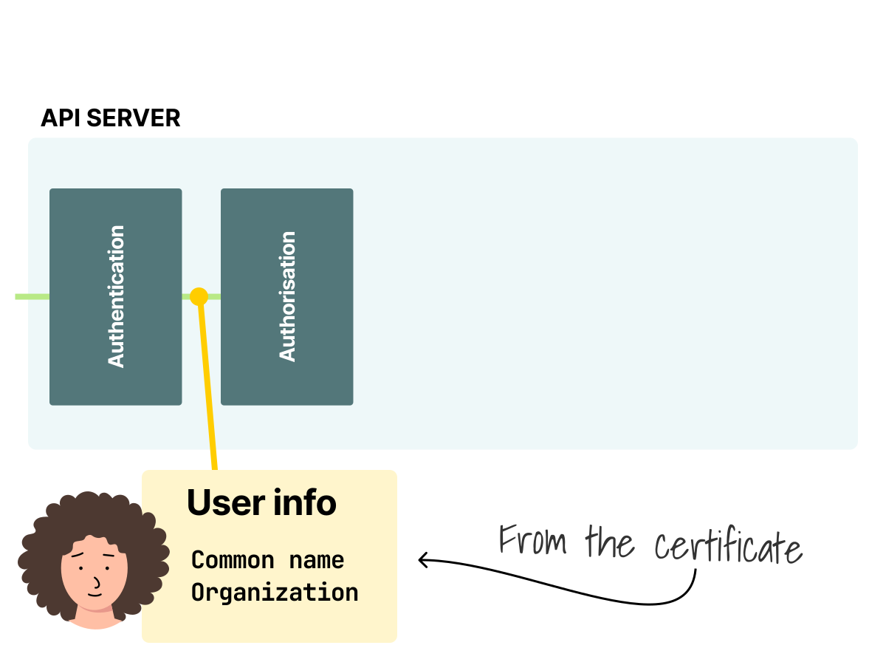
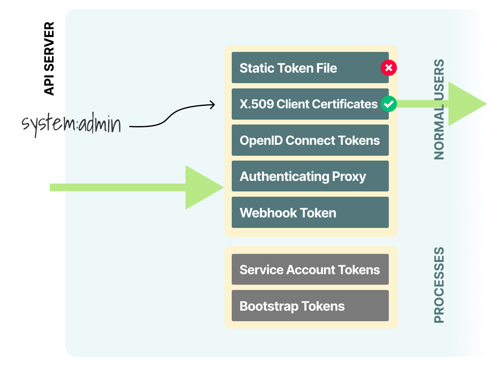
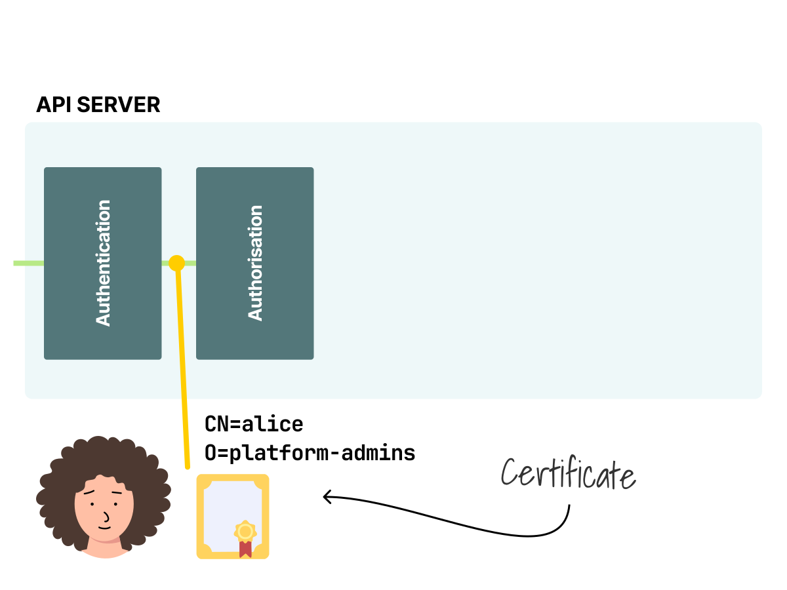
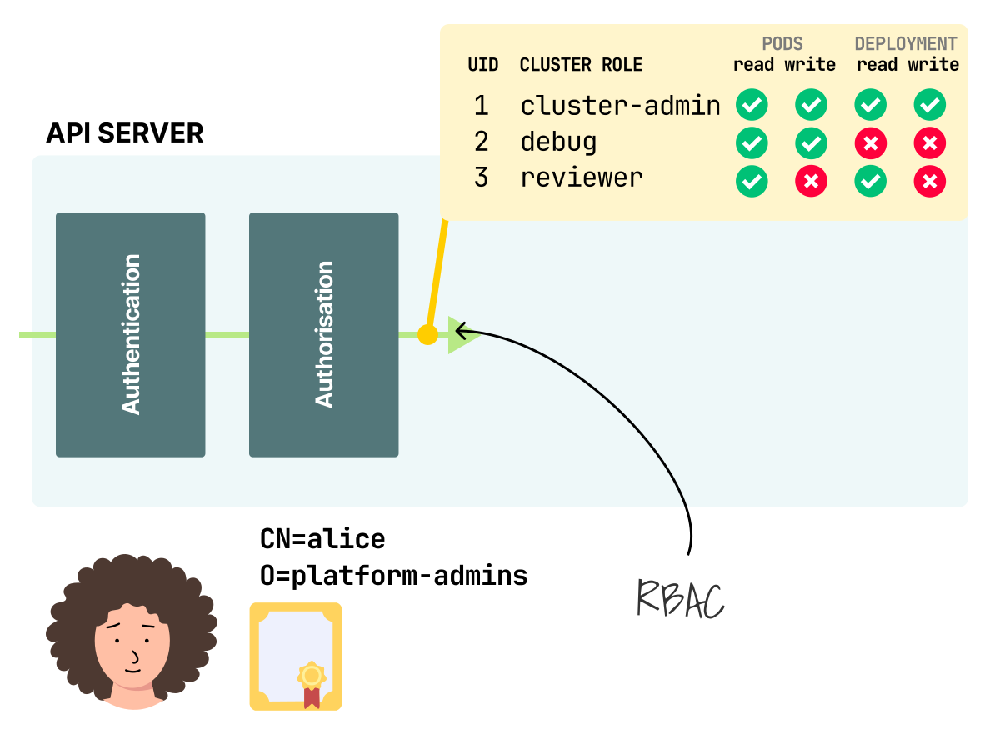
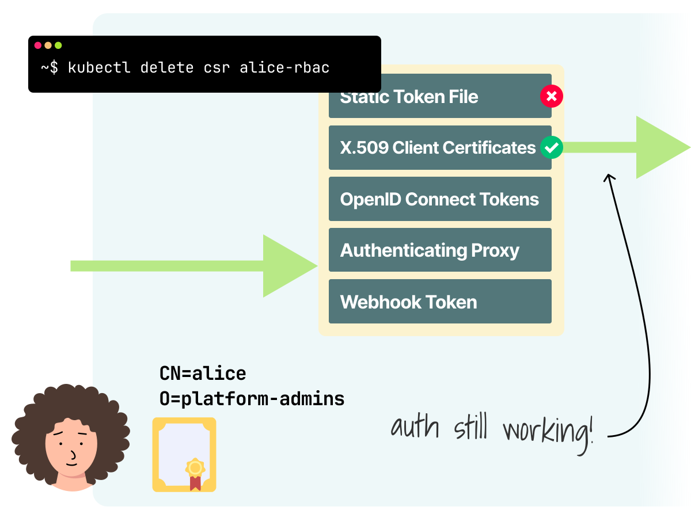
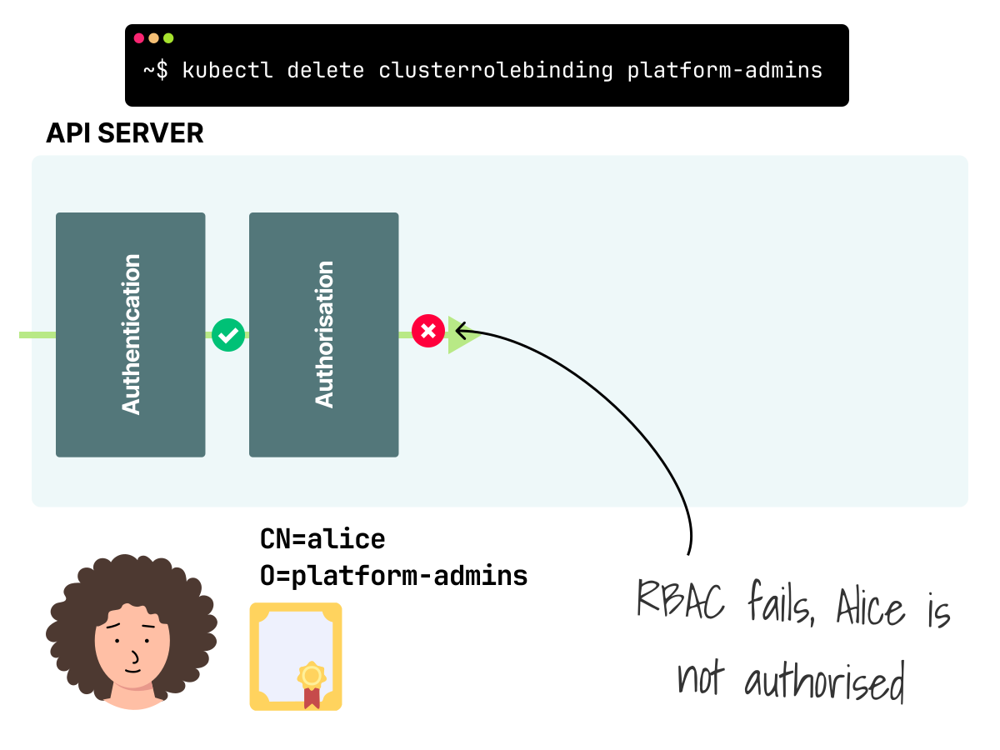
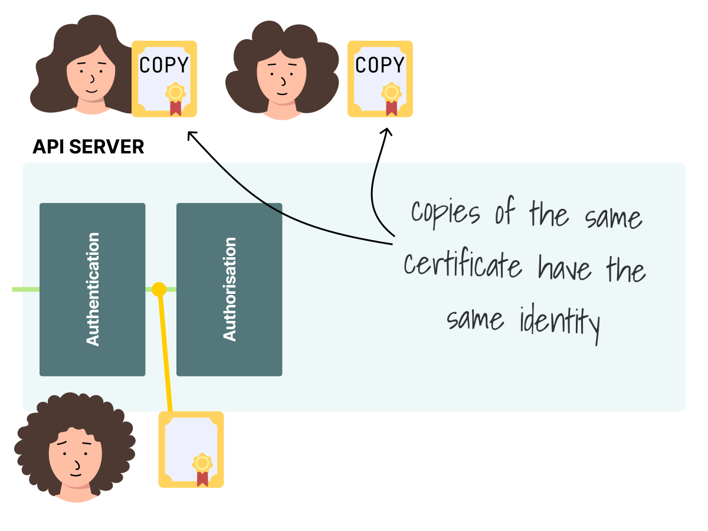
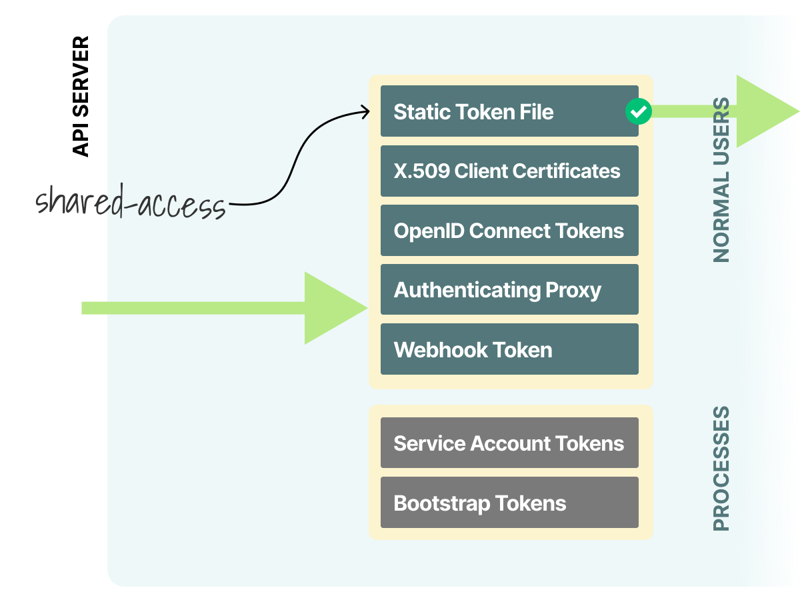
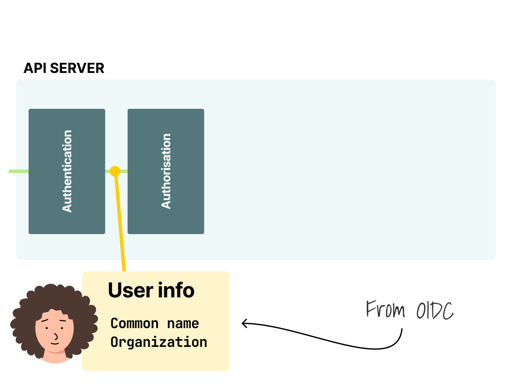
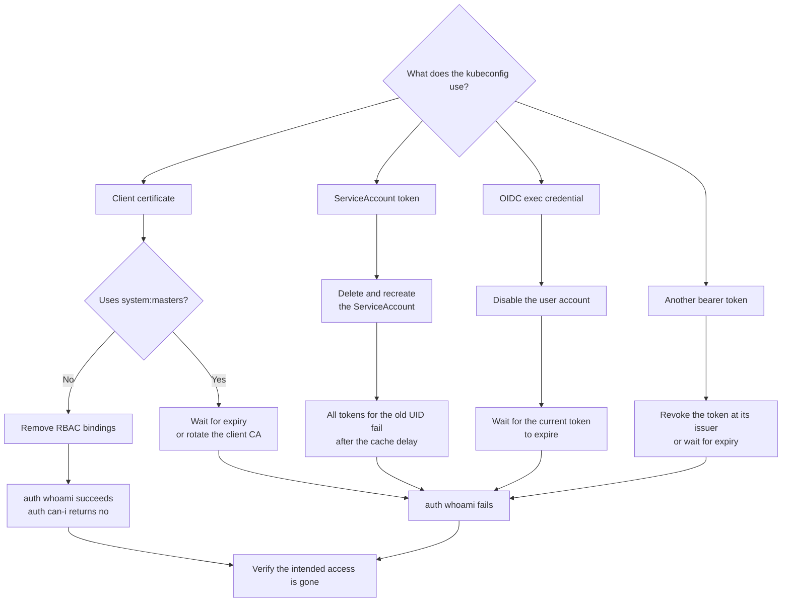

# How to Eliminate Shared Production Kubeconfigs

_TL;DR: A production kubeconfig that contains a certificate or token is a production credential, and every copy then accesses the cluster with the same identity. You should use individual single sign-on (SSO) logins and short-lived credentials for your clusters._

- [What The File Actually Controls](#what-the-file-actually-controls)
- [Why The Certificate Is Hard To Revoke](#why-the-certificate-is-hard-to-revoke)
- [Revoke a Shared ServiceAccount Token](#revoke-a-shared-serviceaccount-token)
- [Fetch a Credential When kubectl Runs](#fetch-a-credential-when-kubectl-runs)
- [Revoke One OIDC User](#revoke-one-oidc-user)
- [Summary](#summary)
- [Individual Kubernetes Access With Teleport](#individual-kubernetes-access-with-teleport)

## What The File Actually Controls

Let's use a k3d cluster to parse the file.

First, read the kubeconfig from disk:

```bash
cat ~/.kube/config
```

The file looks like this, with the encoded data shortened:

```yaml
apiVersion: v1
kind: Config
current-context: k3d-lms-cluster

clusters:
  - name: k3d-lms-cluster
    cluster:
      certificate-authority-data: LS0tLS1CRUdJTi...
      server: https://0.0.0.0:54780

contexts:
  - name: k3d-lms-cluster
    context:
      cluster: k3d-lms-cluster
      user: admin@k3d-lms-cluster

users:
  - name: admin@k3d-lms-cluster
    user:
      client-certificate-data: LS0tLS1CRUdJTi...
      client-key-data: LS0tLS1CRUdJTi...
```

- The `server` value tells `kubectl` where to send a request.
- The `certificate-authority-data` value lets `kubectl` verify the API server.
- The `client-certificate-data` and `client-key-data` fields contain the working certificate and private key.

**If you copy this kubeconfig, you copy the login details, not just the cluster address.**

In this file, `user: admin@k3d-lms-cluster` is only the name of a configuration entry.

But it's the certificate that supplies the real request username and groups.

You can inspect `kubectl auth whoami` to reveal the identity that the API server accepted:

```bash
kubectl auth whoami \
  -o jsonpath='{.status.userInfo.username}{"\n"}{.status.userInfo.groups}{"\n"}'

system:admin
[system:masters system:authenticated]
```

The API server [reads the common name as the username and the organizations as groups](https://kubernetes.io/docs/reference/access-authn-authz/authentication/#x509-client-certificates).

So the certificate supplies `system:admin` (user) and `system:masters` (group).



Next, let's ask what this identity can do across all namespaces:

```bash
kubectl auth can-i '*' '*' --all-namespaces

yes
```

Every copy gets that same `yes`.

**They all have unrestricted access as `system:admin`.**

For comparison, verbose output shows an ordinary request and its response:

```bash
kubectl get namespaces -v=8

I0824 09:39:04.390843 round_trippers.go:527] "Request" verb="GET" \
  url="https://0.0.0.0:54780/api/v1/namespaces?limit=500"
I0824 09:39:04.394418 round_trippers.go:632] "Response" status="200 OK"

NAME              STATUS   AGE
default           Active   14m
kube-node-lease   Active   14m
kube-public       Active   14m
kube-system       Active   14m
```

**In that exchange, the certificate established the `system:admin` identity.**



Authorization allowed the list operation, so the API server returned `200 OK`.

The credentials are fully open (which is already a big problem), but even more importantly, Kubernetes cannot cancel just one copy of this certificate.

**Every copy stays valid until the certificate runs out or the cluster stops trusting its certificate authority (CA).**

## Why The Certificate Is Hard To Revoke

First, decode the client certificate from the k3d kubeconfig and inspect its lifetime:

```bash
yq -r '.users[0].user.client-certificate-data' ~/.kube/config \
  | base64 -d \
  | openssl x509 \
  -noout -subject -issuer -serial -dates

subject=O=system:masters, CN=system:admin
issuer=CN=k3s-client-ca@1787466259
serial=2A4097DE8F1053B6
notBefore=Aug 23 06:24:19 2026 GMT
notAfter=Aug 23 06:24:19 2027 GMT
```

The API server accepts the certificate because `k3s-client-ca` signed it, and it has not expired.

The serial number identifies this certificate, but Kubernetes does not maintain a list of client certificates to cancel.

_Does deleting its CertificateSigningRequest revoke it?_

Let's issue a certificate through the Kubernetes certificates API and test that exact action.

Alice belongs to `platform-admins` instead of `system:masters`, which keeps her permissions under RBAC control.

Create Alice's private key:

```bash
openssl genrsa -out alice-rbac.key 2048
```

Use that key to create a certificate request.

The common name (CN) becomes the username, and the organization (O) becomes the group:

```bash
openssl req \
  -new \
  -key alice-rbac.key \
  -out alice-rbac.csr \
  -subj '/CN=alice/O=platform-admins'
```



The Kubernetes API expects the request as a base64-encoded value:

```bash
CSR_REQUEST=$(base64 -w0 alice-rbac.csr)
```

Submit that value as a Kubernetes `CertificateSigningRequest` for client authentication:

```bash
kubectl apply -f - <<EOF
apiVersion: certificates.k8s.io/v1
kind: CertificateSigningRequest
metadata:
  name: alice-rbac
spec:
  request: ${CSR_REQUEST}
  signerName: kubernetes.io/kube-apiserver-client
  expirationSeconds: 86400
  usages:
    - client auth
EOF

certificatesigningrequest.certificates.k8s.io/alice-rbac created
```

An administrator must approve this request before the built-in signer returns a certificate:

```bash
kubectl certificate approve alice-rbac

certificatesigningrequest.certificates.k8s.io/alice-rbac approved
```

The CSR status now shows that the request is approved and issued:

```bash
kubectl get csr alice-rbac

NAME         AGE   SIGNERNAME                            REQUESTOR       REQUESTEDDURATION   CONDITION
alice-rbac   0s    kubernetes.io/kube-apiserver-client   system:admin   24h                 Approved,Issued
```

The API stores the issued certificate as base64 data.

Decode it and save the certificate as `alice-rbac.crt`:

```bash
kubectl get csr alice-rbac -o jsonpath='{.status.certificate}' \
  | base64 -d \
  | openssl x509 -out alice-rbac.crt
```

The certificate authenticates Alice, but it does not grant permissions on its own.

Bind `platform-admins` to the built-in `cluster-admin` role so that we can test authorization separately:

```bash
kubectl create clusterrolebinding platform-admins \
  --clusterrole=cluster-admin \
  --group=platform-admins

clusterrolebinding.rbac.authorization.k8s.io/platform-admins created
```



Now build Alice's kubeconfig.

First, read the API endpoint from the current kubeconfig:

```bash
SERVER=$(kubectl config view --minify -o jsonpath='{.clusters[0].cluster.server}')
```

The new kubeconfig also needs the server CA.

Decode it from the current kubeconfig:

```bash
yq -r '.clusters[0].cluster.certificate-authority-data' ~/.kube/config \
  | base64 -d > k3d-server-ca.crt
```

Create the cluster entry with the API endpoint and server CA:

```bash
kubectl config set-cluster k3d-lms-cluster \
  --server="$SERVER" \
  --certificate-authority=k3d-server-ca.crt \
  --embed-certs=true \
  --kubeconfig=alice-rbac.yaml
```

Create Alice's user entry with her certificate and private key:

```bash
kubectl config set-credentials alice \
  --client-certificate=alice-rbac.crt \
  --client-key=alice-rbac.key \
  --embed-certs=true \
  --kubeconfig=alice-rbac.yaml
```

Create a context that joins the cluster entry to Alice's user entry:

```bash
kubectl config set-context k3d-lms-cluster \
  --cluster=k3d-lms-cluster \
  --user=alice \
  --kubeconfig=alice-rbac.yaml
```

Select that context when this kubeconfig is used:

```bash
kubectl config use-context k3d-lms-cluster --kubeconfig=alice-rbac.yaml
```

The certificate contains the identity and expires after one day:

```bash
openssl x509 -in alice-rbac.crt -noout -subject -issuer -serial -dates

subject=O=platform-admins, CN=alice
issuer=CN=k3s-client-ca@1787466259
serial=552324C39D60644E9C231EC70C2E29C8
notBefore=Aug 24 07:02:53 2026 GMT
notAfter=Aug 25 07:02:53 2026 GMT
```

Alice's kubeconfig authenticates as the username and groups from her certificate:

```bash
kubectl --kubeconfig=alice-rbac.yaml auth whoami \
  -o jsonpath='{.status.userInfo.username}{"\n"}{.status.userInfo.groups}{"\n"}'

alice
[platform-admins system:authenticated]
```

The ClusterRoleBinding lets that group perform every action:

```bash
kubectl --kubeconfig=alice-rbac.yaml auth can-i '*' '*' --all-namespaces

yes
```

Delete the [`CertificateSigningRequest`](https://kubernetes.io/docs/reference/access-authn-authz/certificate-signing-requests/):

```bash
kubectl delete csr alice-rbac

certificatesigningrequest.certificates.k8s.io "alice-rbac" deleted
```

The issued certificate still authenticates Alice:

```bash
kubectl --kubeconfig=alice-rbac.yaml auth whoami -o jsonpath='{.status.userInfo.username}{"\n"}'
alice
```



Her group also keeps its permission:

```bash
kubectl --kubeconfig=alice-rbac.yaml auth can-i '*' '*' --all-namespaces
yes
```

**Deleting the CSR removes the record of the certificate, but the signed certificate still works until it expires.**

_Can you remove Alice's access without revoking the certificate?_

Yes, because Alice receives her permissions through RBAC.

Delete the binding:

```bash
kubectl delete clusterrolebinding platform-admins

clusterrolebinding.rbac.authorization.k8s.io "platform-admins" deleted
```

The certificate still authenticates Alice:

```bash
kubectl --kubeconfig=alice-rbac.yaml auth whoami -o jsonpath='{.status.userInfo.username}{"\n"}'
alice
```

Without the binding, Alice no longer has unrestricted access:

```bash
kubectl --kubeconfig=alice-rbac.yaml auth can-i '*' '*' --all-namespaces
no
```

**RBAC took away Alice's permission right away, but her certificate still identified her as `alice`.**



Could you keep the shared kubeconfig and fix it to use RBAC?_

No, because RBAC controls access based on the username and groups the API server has already verified.

If five people copied `alice-rbac.yaml`, each would appear as `alice` and get the same RBAC permissions for the same request.

Deleting the binding would remove that permission from all five copies, not just one person's.



_Can RBAC restrict the shared `system:admin` (user) certificate?_

Its `system:masters` (group) [bypasses RBAC and webhook authorization](https://kubernetes.io/docs/concepts/security/rbac-good-practices/#least-privilege).

No RoleBinding or ClusterRoleBinding can limit that credential.

You have to wait for it to expire or remove its certificate authority (CA) from the API server's trusted list.

The second option means replacing the CA for the whole cluster.

K3s uses the same client CA for the admin credentials and internal clients.

The K3s certificate command shows some of them:

```bash
docker exec k3d-lms-cluster-server-0 \
  k3s certificate check --output table

FILENAME                    SUBJECT                     USAGES
client-admin.crt            system:admin                ClientAuth
client-kube-proxy.crt       system:kube-proxy           ClientAuth
client-kubelet.crt          system:node:k3d-lms-cluster ClientAuth
client-k3s-controller.crt   system:k3s-controller       ClientAuth
```

Rotating only `client-admin.crt` does not revoke a copied kubeconfig.

The old certificate still links to the trusted `k3s-client-ca`.

K3s therefore, [requires a full CA replacement](https://docs.k3s.io/cli/certificate#rotating-self-signed-ca-certificates) to invalidate a compromised admin kubeconfig.

The new CA files must be staged outside `/var/lib/rancher/k3s/server/tls` and loaded with:

```bash
docker exec k3d-lms-cluster-server-0 \
  k3s certificate rotate-ca \
  --path=/var/lib/rancher/k3s/server/rotate-ca
```

K3s must then restart on every server and agent.

A new root CA also changes secure join tokens and can require Pod restarts.

**The rotation cancels the copied admin certificate, but it also changes trust for the cluster's other clients.**

That is the cost of revoking this `system:masters` certificate before it expires.

_If client certificates are this difficult to revoke, why use them for human access?_

A small, single-user cluster [may choose simple certificate authentication](https://kubernetes.io/docs/tasks/administer-cluster/securing-a-cluster/#api-authentication).

`kubeadm` also [puts a client certificate in `admin.conf`](https://kubernetes.io/docs/reference/setup-tools/kubeadm/implementation-details/#generate-kubeconfig-files-for-control-plane-components), which must stay on the control plane nodes instead of being shared with additional users.

_Would a shared bearer token be easier?_

## Revoke a Shared ServiceAccount Token

A bearer token in kubeconfig still gives every copy the same login details:

```yaml
users:
  - name: shared-access
    user:
      token: <bearer-token>
```

Let's build two kubeconfigs using a single short-lived ServiceAccount token.

Create a namespace for the example:

```bash
kubectl create namespace kubeconfig-demo

namespace/kubeconfig-demo created
```

Create the `shared-access` ServiceAccount in that namespace:

```bash
kubectl --namespace=kubeconfig-demo create serviceaccount shared-access

serviceaccount/shared-access created
```

Give the ServiceAccount read-only access in the namespace:

```bash
kubectl --namespace=kubeconfig-demo create rolebinding shared-access-view \
  --clusterrole=view \
  --serviceaccount=kubeconfig-demo:shared-access

rolebinding.rbac.authorization.k8s.io/shared-access-view created
```

Request a token that expires after ten minutes and keep it in a shell variable:

```bash
TOKEN=$(kubectl --namespace=kubeconfig-demo \
  create token shared-access --duration=10m)
```

Read the API endpoint from the current kubeconfig:

```bash
SERVER=$(kubectl config view --minify -o jsonpath='{.clusters[0].cluster.server}')
```

Create the cluster entry in `shared-token.yaml`.

It uses the server CA that we extracted earlier:

```bash
kubectl config set-cluster k3d-lms-cluster \
  --server="$SERVER" \
  --certificate-authority=k3d-server-ca.crt \
  --embed-certs=true \
  --kubeconfig=shared-token.yaml
```

Create a user entry that contains the ServiceAccount token:

```bash
kubectl config set-credentials shared-access \
  --token="$TOKEN" \
  --kubeconfig=shared-token.yaml
```

Join the cluster and user entries in a context.

The context also selects `kubeconfig-demo` as the default namespace:

```bash
kubectl config set-context k3d-lms-cluster \
  --cluster=k3d-lms-cluster \
  --user=shared-access \
  --namespace=kubeconfig-demo \
  --kubeconfig=shared-token.yaml
```

Select that context:

```bash
kubectl config use-context k3d-lms-cluster --kubeconfig=shared-token.yaml
```

Copy the file to reproduce a shared kubeconfig:

```bash
cp shared-token.yaml shared-token-copy.yaml
```

The first file authenticates as the ServiceAccount:

```bash
kubectl --kubeconfig=shared-token.yaml \
  auth whoami -o jsonpath='{.status.userInfo.username}{"\n"}'
system:serviceaccount:kubeconfig-demo:shared-access
```



The copy returns the same username because it contains the same token:

```bash
kubectl --kubeconfig=shared-token-copy.yaml \
  auth whoami -o jsonpath='{.status.userInfo.username}{"\n"}'
system:serviceaccount:kubeconfig-demo:shared-access
```

The RoleBinding gives either copy permission to read Pods:

```bash
kubectl --kubeconfig=shared-token.yaml auth can-i get pods
yes
```

Kubernetes cannot revoke only one of these token copies because it does not keep a central record of individual short-lived ServiceAccount tokens](<https://kubernetes.io/docs/reference/access-authn-authz/service-accounts-admin/#deleteinvalidate-a-short-lived-serviceaccount-token>).

Deleting and recreating the ServiceAccount changes its UID, invalidating all tokens issued under the old UID.

_Does that happen the moment `kubectl delete` returns?_

The token was already accepted, and the API server kept that result in memory for about ten seconds.

The timing test shows the gap:

```text
system:serviceaccount:kubeconfig-demo:shared-access
delete started: 07:50:24 UTC
serviceaccount "shared-access" deleted from kubeconfig-demo namespace
delete returned: 07:50:24 UTC
attempt 1 at 07:50:24 UTC
system:serviceaccount:kubeconfig-demo:shared-access
attempt 2 at 07:50:29 UTC
system:serviceaccount:kubeconfig-demo:shared-access
attempt 3 at 07:50:34 UTC
error: You must be logged in to the server (Unauthorized)
```

After the cached result disappeared, the original file failed:

```bash
kubectl --kubeconfig=shared-token.yaml auth whoami
error: You must be logged in to the server (Unauthorized)
```

The copied file failed for the same reason:

```bash
kubectl --kubeconfig=shared-token-copy.yaml auth whoami
error: You must be logged in to the server (Unauthorized)
```

**Deleting the ServiceAccount canceled every copy after a short delay, but it could not remove access for just one person.**

The ten-minute expiry limited the damage if deletion failed or nobody knew which ServiceAccount created the token.

_How can a kubeconfig avoid carrying the token in the first place?_

## Fetch a Credential When kubectl Runs

Replacing one shared secret with another does not fix the problem.

A better choice is to stop putting the secret in the kubeconfig from the start.

That is what the [`exec` field](https://kubernetes.io/docs/reference/access-authn-authz/authentication/#client-go-credential-plugins) is for: before making a request, `kubectl` asks another program for a credential.

The following entry uses `kubelogin` and an OpenID Connect provider:

```yaml
users:
  - name: production-oidc
    user:
      exec:
        apiVersion: client.authentication.k8s.io/v1
        command: kubelogin
        args:
          - get-token
          - --oidc-issuer-url=https://login.example.com
          - --oidc-client-id=kubectl
        interactiveMode: IfAvailable
```

Look at what remains in the file.

**The file has a command, an issuer, and a client ID, but no client certificate, private key, token, or password.**

Those are login instructions.

Once `kubectl` needs a token, the plugin signs in whoever is at the keyboard and returns an `ExecCredential` on standard output.

I gave Dex a deliberately silly one-minute ID-token lifetime in the lab.

Production tokens usually last longer, but waiting an hour for each one to expire would slow the test.

Store Alice's demo password in a shell variable:

```bash
DEX_DEMO_PASSWORD=password
```

Ask `kubelogin` for Alice's token:

```bash
kubelogin get-token \
  --oidc-issuer-url=https://dex.k3d.test:5556/dex \
  --oidc-client-id=kubectl \
  --oidc-extra-scope=email \
  --certificate-authority=dex-tls.crt \
  --grant-type=password \
  --username=alice@example.com \
  --password="$DEX_DEMO_PASSWORD" \
  --token-cache-dir=alice-cache
```

The command returns an `ExecCredential` with the token and its `expirationTimestamp`.

**Until that time, `kubectl` can reuse the credentials.**

A `401 Unauthorized` from the API server also sends it back through the login path.

Of course, the API server also has tasks to handle.

It must [trust the issuer and client ID](https://kubernetes.io/docs/reference/access-authn-authz/authentication/#openid-connect-tokens), then map one of the token claims to a username.

These are API server startup flags.

For the lab, I passed them through K3s when I created the K3d cluster:

```bash
k3d cluster create lms-cluster \
  --volume "$PWD/dex-tls.crt:/var/lib/rancher/k3s/server/tls/dex-ca.crt@server:*" \
  --k3s-arg '--kube-apiserver-arg=oidc-ca-file=/var/lib/rancher/k3s/server/tls/dex-ca.crt@server:*' \
  --k3s-arg '--kube-apiserver-arg=oidc-client-id=kubectl@server:*' \
  --k3s-arg '--kube-apiserver-arg=oidc-issuer-url=https://dex.k3d.test:5556/dex@server:*' \
  --k3s-arg '--kube-apiserver-arg=oidc-username-claim=email@server:*'
```

The volume mounts the Dex CA into each server container.

The `--k3s-arg` options forward the four OIDC settings to the Kubernetes API server.

With the `email` claim in place, Alice's kubeconfig returns her email address:

```bash
kubectl --kubeconfig=alice-oidc.yaml auth whoami

ATTRIBUTE   VALUE
Username    alice@example.com
Groups      [system:authenticated]
```

Bob's kubeconfig returns a different identity:

```bash
kubectl --kubeconfig=bob-oidc.yaml auth whoami

ATTRIBUTE   VALUE
Username    bob@example.com
Groups      [system:authenticated]
```

**To the API server, these are two different people, not two copies. They can have separate RBAC permissions and separate audit logs.**



There is a catch, and it matters whenever a kubeconfig comes from an unfamiliar source.

The `exec` command runs on the engineer's machine and executes a real program.

Now, let's revisit the revoking mechanism.

## Revoke One OIDC User

For the offboarding test, Alice and Bob both started with tokens that expired at `07:34:36Z`:

```text
alice token expires at 2026-08-24T07:34:36Z
bob token expires at 2026-08-24T07:34:36Z
```

At `07:33:36Z`, I disabled Alice's account in Dex.

This removed her ability to obtain another token but did not invalidate her current token.

Alice's next request still succeeded.

The token in Alice's cache was already signed, and the API server could verify it without calling Dex.

For the remainder of that minute, her old identity still worked:

```bash
kubectl --kubeconfig=alice-oidc.yaml \
  auth whoami -o jsonpath='{.status.userInfo.username}{"\n"}'
alice@example.com
```

Bob's identity also continued to work:

```bash
kubectl --kubeconfig=bob-oidc.yaml \
  auth whoami -o jsonpath='{.status.userInfo.username}{"\n"}'
bob@example.com
```

Alice also kept her existing permission:

```bash
kubectl --kubeconfig=alice-oidc.yaml auth can-i get pods
yes
```

Five seconds after the deadline, Alice tried again.

Her cached token was now useless, so `kubelogin` went back to Dex for a fresh login and found that the account was gone:

```text
Password:
error: get-token: authentication error: ropc error: oauth2: "access_denied" "Invalid username or password"
Unable to connect to the server: getting credentials: exec: executable kubelogin failed with exit code 1
```

Bob's cache expired, too, but this is where the separate identities paid off.

Dex still knew Bob, issued him another token, and his command was completed:

```bash
kubectl --kubeconfig=bob-oidc.yaml auth whoami

Password:
ATTRIBUTE   VALUE
Username    bob@example.com
Groups      [system:authenticated]
```

> Please note that the password prompt is only a quirk of this reproducible lab, which uses the Dex local-password connector. In production, you should expect a browser, a device flow, or a company CLI instead.

**Removing the account did not erase Alice's current token, but it blocked her next login.**

Bob's access was untouched.

Remember that the one-minute delay was not a special feature of Dex or Kubernetes.

It came from the token lifetime configured for the lab.

Without extra checks to cancel tokens, the token's lifetime is the longest delay before access is removed.

The replacement kubeconfig can still contain the cluster endpoint and login command.

The plugin must return a separate, short-lived credential with an expiration time for each user ([an expiration time](https://kubernetes.io/docs/reference/config-api/client-authentication.v1/#execcredentialstatus)).

After it expires, `kubectl` asks the plugin again instead of reusing the old login.

RBAC works on the [username and groups](https://kubernetes.io/docs/reference/access-authn-authz/authorization/index.html#request-attributes-used-in-authorization) from that login.

## Summary

The important result from this lab is that each credential behaves differently when you try to remove access.

- Deleting a CSR did nothing to its signed certificate.
- RBAC stopped an ordinary certificate identity, but it could not distinguish five people using that identity.
- Recreating a ServiceAccount killed every token for the old UID, and removing a client CA also took out the control plane clients that still depended on it.



That leaves me with a simple rule: if a kubeconfig contains a reusable certificate or token, treat the entire file as a production credential.

For most people, an exec plugin and an individual SSO login are a much less painful combination.

There is still an offboarding delay while the final token remains valid, but a disabled account no longer removes access for everyone else.

## Individual Kubernetes Access With Teleport

Each engineer needs a separate login and a credential that expires to replace a shared production kubeconfig.

Teleport Kubernetes Access supports this model with company SSO and short-lived certificates for access through its proxy.

Engineers continue to use `kubectl`, while Teleport roles control which clusters they can access and which Kubernetes identities they can assume.

The team can grant access to Alice and Bob individually rather than share copies of one production credential.

[Learn more about Kubernetes access with Teleport](https://goteleport.com/platform/protected-identities/kubernetes/).
