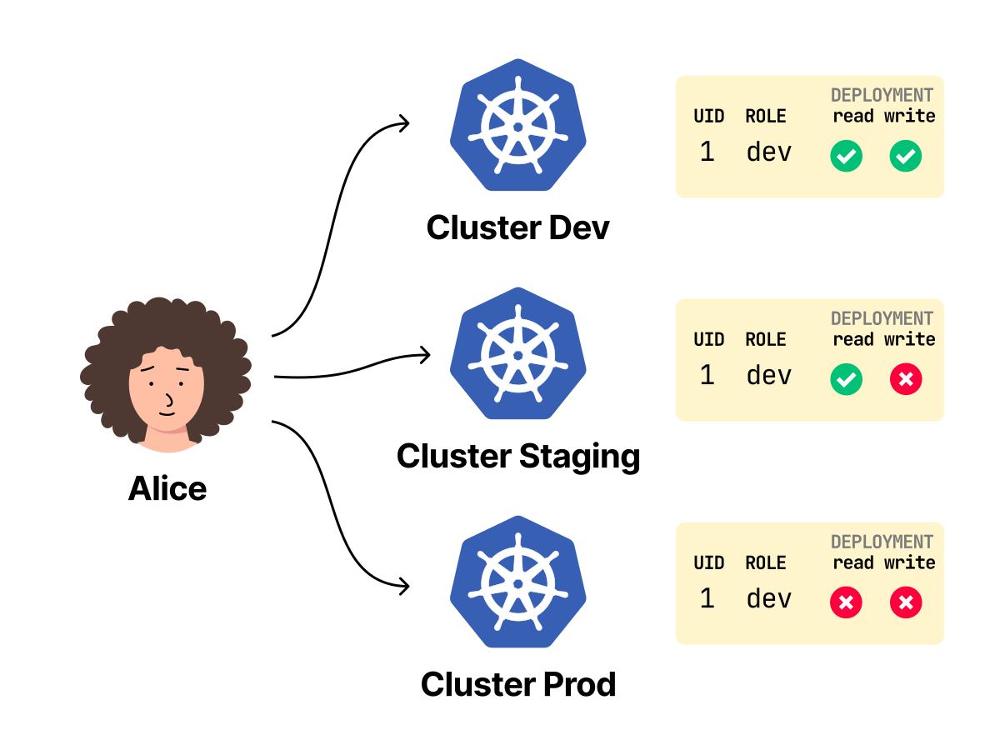
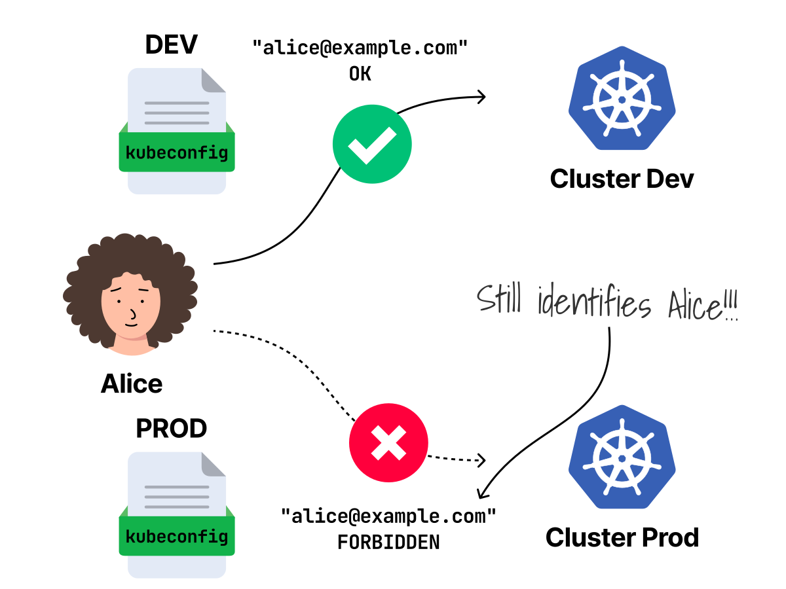
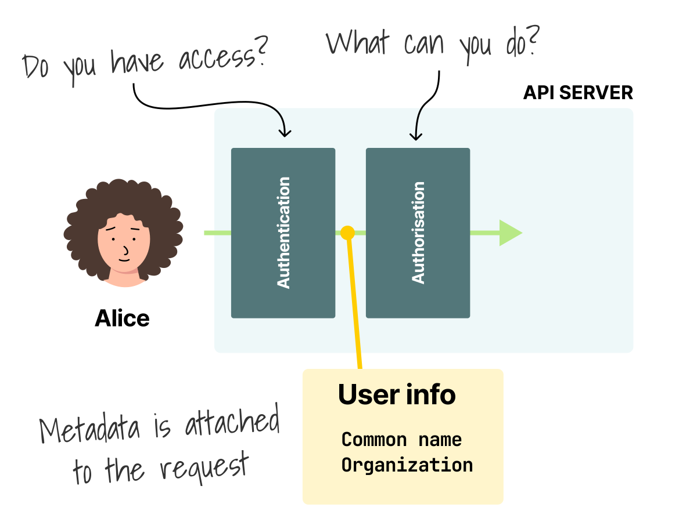
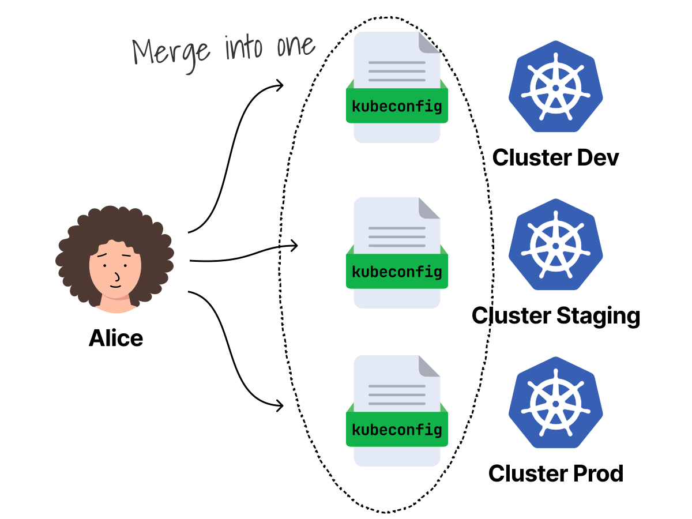
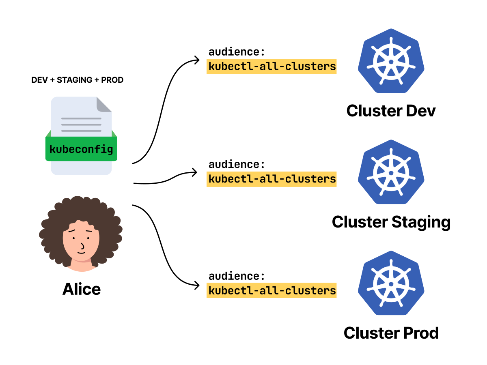
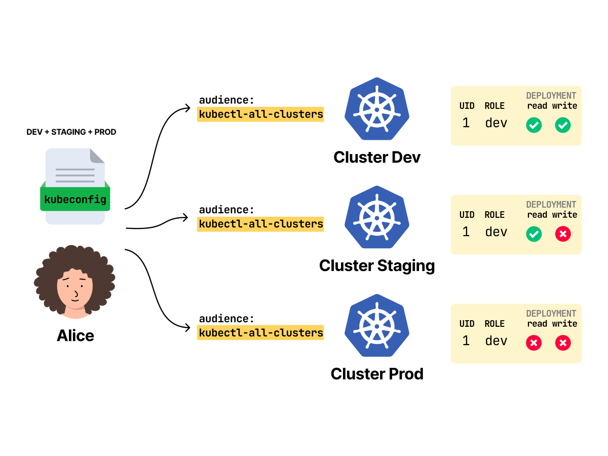
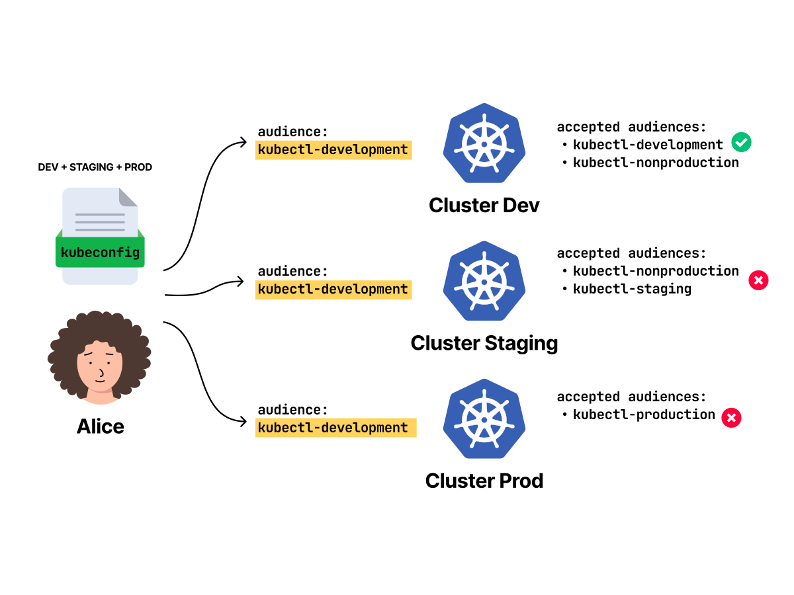
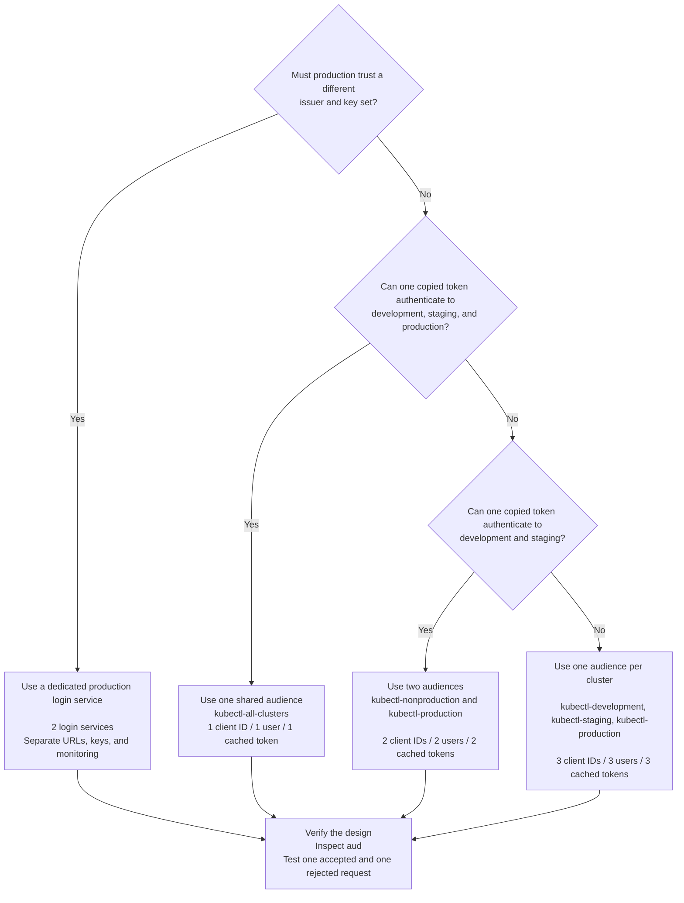

# SSO-Backed kubectl Access Across Many Clusters

_TL;DR: If your development, staging, and production API servers all trust the same OIDC issuer and audience, Kubernetes will accept the same cached kubectl token across all of them. You should use separate audiences in your API._

- [One Company Login for Development, Staging, and Production](#one-company-login-for-development-staging-and-production)
- [Authentication Comes Before Permissions](#authentication-comes-before-permissions)
- [The API Server Reads `iss`, `aud`, and `email`](#the-api-server-reads-iss-aud-and-email)
- [One Shared Audience Means One Token for Three API Servers](#one-shared-audience-means-one-token-for-three-api-servers)
- [RBAC Rejects Alice's Production Command](#rbac-rejects-alices-production-command)
- [Make Production Reject a Development Token](#make-production-reject-a-development-token)
- [A Staging Context Can Request a Development Token](#a-staging-context-can-request-a-development-token)
- [Keep Production Separate From Non-Production](#keep-production-separate-from-non-production)
- [Choose Which Audiences Each API Server Accepts](#choose-which-audiences-each-api-server-accepts)
- [Centralize Cluster Access With Teleport](#centralize-cluster-access-with-teleport)

## One Company Login for Development, Staging, and Production

A platform team manages three Kubernetes clusters: development, staging, and production.

**Each cluster has an API server, the Kubernetes component that receives `kubectl` requests.**

The team connects all three API servers to the company login service, so Alice can sign in with her usual work account.

Now Alice can log in, but each API server still needs to decide which tokens to accept.

Alice is a developer.

She can delete Deployments in development, read them in staging, but has no access to the `application` namespace in production.



**These are authorization rules, and each cluster can have its own set.**

She signs in, chooses development in her kubeconfig file, and runs `kubectl get pods -n application`:

1. The kubeconfig file tells `kubectl` which API server to use and how to get a login token.
1. The login service gives `kubectl` a signed token that identifies Alice.
1. The development cluster accepts the token and returns the Pods.

Next, she selects the production namespace in the same kubeconfig and runs the same command with the same token.

Production rejects the command with `Forbidden`:

```bash
kubectl --kubeconfig="$HOME/.kube/all-clusters.yaml" \
  --context=sso-production \
  get pods -n application

Error from server (Forbidden): pods is forbidden: User "alice@example.com" cannot list resource
"pods" in API group "" in the namespace "application"
```

But production still recognized that the request came from `alice@example.com`.

_If production rejected the command, why did the error still identify Alice?_



The answer lies in the order the API server uses.

## Authentication Comes Before Permissions

When production receives Alice's `get pods` command, the API server makes two decisions in order.

First, it checks whether the token is acceptable.

This authentication step returns [`401 Unauthorized`](https://kubernetes.io/docs/reference/access-authn-authz/authentication/#anonymous-requests) when the token fails.

If the token passes, the API server maps it to a Kubernetes username.

Here, that username is `alice@example.com`.

Only then does the API server ask whether Alice may list Pods in the `application` namespace.

This authorization step uses role-based access control (RBAC) to grant Alice different permissions across development, staging, and production.

If RBAC allows the action, the API server returns the Pods.

If RBAC denies the action, the API server returns [`403 Forbidden`](https://kubernetes.io/docs/reference/access-authn-authz/authorization/).



Authentication identifies Alice before RBAC decides what actions she can take.

This order matters because production can reject Alice in two different ways:

- Authentication can reject the token before Alice becomes a Kubernetes username.
- RBAC can reject her command after production accepts the token.

The token's audience, usually called `aud`, is what allows the first type of rejection.

It specifies the kubectl client for which the token was created.

The API server uses `aud` to decide whether to accept or reject a token from the login service.

## The API Server Reads `iss`, `aud`, and `email`

Alice signs in through a login service, also called an identity provider.

Okta, Microsoft Entra ID, Keycloak, Dex, and other OIDC providers can give `kubectl` a signed token.

Kubernetes receives the same kind of JWT when the provider returns the same claims.

The token is a JSON Web Token (JWT) with fields that the API server can verify.

These fields are called **claims**.

Three claims matter here:

- `iss` is the issuer URL that identifies the login service.
- `aud` is the audience value.
- `email` is the username claim that Kubernetes maps to Alice.

The API server [checks the token's issuer, audience, and username claim](https://kubernetes.io/docs/reference/access-authn-authz/authentication/#using-authentication-configuration) before it accepts the token.

Once the check passes, the API server maps the token to a username.

That's why the `aud` claim is important in the API server's decision, no matter which login service created the token.

Let's test this locally using Dex and kubelogin (we need this so that `kubectl` can run a credential helper and read a [JSON response called `ExecCredential`](https://kubernetes.io/docs/reference/config-api/client-authentication.v1/#client-authentication-k8s-io-v1-ExecCredential)).

Create three clusters: development, staging, and production, all accepting one audience named `kubectl-all-clusters`.

At first, each cluster has its own kubeconfig file, which would make Alice swap files to connect to each cluster.

But you can merge all three into one file:

```bash
env KUBECONFIG="$HOME/.kube/development.yaml:$HOME/.kube/staging.yaml:$HOME/.kube/production.yaml" \
  kubectl config view --flatten --raw > "$HOME/.kube/all-clusters.yaml"
```

The merged kubeconfig now contains development, staging, and production.



A kubeconfig [context connects a cluster to a user entry](https://kubernetes.io/docs/concepts/configuration/organize-cluster-access-kubeconfig/#context).

Here is the relevant part of the merged file:

```yaml
clusters:
  - name: development
    cluster:
      server: https://development.example.com
  - name: staging
    cluster:
      server: https://staging.example.com
  - name: production
    cluster:
      server: https://production.example.com
contexts:
  - name: sso-development
    context:
      cluster: development
      user: oidc-all-clusters
  - name: sso-staging
    context:
      cluster: staging
      user: oidc-all-clusters
  - name: sso-production
    context:
      cluster: production
      user: oidc-all-clusters
users:
  - name: oidc-all-clusters
    user:
      exec:
        apiVersion: client.authentication.k8s.io/v1beta1
        command: kubectl
        args:
          - oidc-login
          - get-token
          - --oidc-issuer-url=https://dex.127.0.0.1.sslip.io:5556/dex
          - --certificate-authority=/absolute/path/to/dex-ca.crt
          - --oidc-client-id=kubectl-all-clusters
```

The excerpt has three sections:

- `clusters` names each cluster and gives `kubectl` its API server URL.
- `users` defines how `kubectl` gets a credential.
- `contexts` connects one cluster entry to one user entry.

For example, the `sso-staging` context selects the `staging` cluster and the `oidc-all-clusters` user.

`kubectl` sends the request to the staging API server, then runs the `exec` command from the selected user entry.

That command runs `kubectl oidc-login get-token`, the kubelogin credential plugin, with the client ID `kubectl-all-clusters`.

The name `oidc-all-clusters` is only a local kubeconfig key.

The `--oidc-client-id` argument selects the OIDC client.

The login service puts that client ID in the token's `aud` claim.

All three contexts select different cluster entries, but they select the same user entry and client ID.

Development, staging, and production all request the same audience, regardless of the context Alice chooses.



Now the kubeconfig can reach development, staging, and production. But what does the token look like?

## One Shared Audience Means One Token for Three API Servers

The previous kubeconfig assigned the same OIDC client to all clusters: `kubectl-all-clusters`.

When Alice logs in, she asks the login service for credentials for that client and receives one token for `kubectl-all-clusters`.

_But will all three API servers accept it?_

To answer that, look at the token Alice receives.

The API server does not ask the login service about Alice every time she runs `kubectl`.

It already has the rules it needs: which issuer URL it trusts, which audiences it accepts, and which public keys can verify the token signature.

Kubelogin has a `setup` command that signs Alice in and prints the claims from the returned token.

Use the issuer URL, certificate path, and client ID from the `oidc-all-clusters` user entry shown above:

```bash
kubectl oidc-login setup \
  --oidc-issuer-url=https://dex.127.0.0.1.sslip.io:5556/dex \
  --oidc-client-id=kubectl-all-clusters \
  --oidc-extra-scope=email \
  --certificate-authority=/absolute/path/to/dex-ca.crt
```

Kubelogin opens a browser for Alice's login, then prints the token claims.

The relevant output is:

```text
You got a token with the following claims:

{
  "iss": "https://dex.127.0.0.1.sslip.io:5556/dex",
  "aud": "kubectl-all-clusters",
  "email": "alice@example.com",
  "exp": 1787680851
}
```

Alice is the `email` value, the token came from the `iss` URL, and it stops working after the time stored in `exp`.

The field that matters for this test is `aud`, because its value is `kubectl-all-clusters`.

That means the login service created this token for the shared kubectl client.

_Will a token with this audience work against all three API servers?_

All three contexts use the same `oidc-all-clusters` user entry, so kubelogin reuses the same cached token for the three requests.

Run `kubectl auth whoami` against each context:

```bash
for ENVIRONMENT in development staging production; do
  printf '%s: ' "$ENVIRONMENT"

  kubectl --kubeconfig="$HOME/.kube/all-clusters.yaml" \
    --context="sso-$ENVIRONMENT" \
    auth whoami \
    -o jsonpath='{.status.userInfo.username}{"\n"}'
done

development: alice@example.com
staging: alice@example.com
production: alice@example.com
```

The output shows that the same token returned Alice's username from production as well.

Kubelogin [stores tokens on the filesystem by default](https://github.com/int128/kubelogin#token-cache), including the token it sends to Kubernetes and another token it can use to get a fresh one.

If Alice's cached token leaves her workstation, whoever holds it can authenticate to production as Alice until the token expires.

With a shared audience, Alice has a single cached token that authenticates her across development, staging, and production.

At this point, production has only recognized Alice. Kubernetes still needs to decide what actions she can take.

_Can RBAC stop Alice from changing production?_

## RBAC Rejects Alice's Production Command

The same token has now passed authentication in development, staging, and production, but authentication only tells Kubernetes who made the request.

Authorization decides whether Alice can read Pods, delete Deployments, or run a command in production, and RBAC is the authorization system used here.

Each cluster can give `alice@example.com` a different set of actions with its own [RoleBinding](https://kubernetes.io/docs/reference/access-authn-authz/rbac/#rolebinding-and-clusterrolebinding), which grants a Role to a user, group, or ServiceAccount in one namespace.

Alice can read Pods and Deployments, and delete Deployments in development; read Pods and Deployments in staging; and has no permission in the `application` namespace in production.

_What happens when the same accepted token asks for those actions?_

Use `ALL_CLUSTERS_TOKEN` to ask development, staging, and production whether Alice can read Pods and delete Deployments:

```bash
for ENVIRONMENT in development staging production; do
  CONTEXT="sso-$ENVIRONMENT"

  printf '%s get pods: ' "$ENVIRONMENT"
  kubectl --kubeconfig="$TOKEN_TARGETS" \
    --context="$CONTEXT" \
    --token="$ALL_CLUSTERS_TOKEN" \
    auth can-i get pods -n application

  printf '%s delete deployments: ' "$ENVIRONMENT"
  kubectl --kubeconfig="$TOKEN_TARGETS" \
    --context="$CONTEXT" \
    --token="$ALL_CLUSTERS_TOKEN" \
    auth can-i delete deployments -n application
done

development get pods: yes
development delete deployments: yes
staging get pods: yes
staging delete deployments: no
production get pods: no
production delete deployments: no
```

The token did not change across those six checks, but the answers changed as each API server applied its own RBAC rules.

Development returns two `yes` answers because Alice can read and delete there, staging returns `yes` for the read and `no` for the delete, and production returns `no` twice because Alice has no permission in the `application` namespace.



Those `no` answers are authorization decisions for `alice@example.com`, not authentication failures.

Because `auth can-i` only asks Kubernetes what will happen, compare those answers with these recorded API requests:

```bash
kubectl --kubeconfig="$TOKEN_TARGETS" \
  --context=sso-development \
  --token="$ALL_CLUSTERS_TOKEN" \
  get deployment web -n application -o name

deployment.apps/web

kubectl --kubeconfig="$TOKEN_TARGETS" \
  --context=sso-staging \
  --token="$ALL_CLUSTERS_TOKEN" \
  delete deployment web -n application

Error from server (Forbidden): deployments.apps "web" is forbidden: User "alice@example.com" cannot delete resource
"deployments" in API group "apps" in the namespace "application"

kubectl --kubeconfig="$TOKEN_TARGETS" \
  --context=sso-production \
  --token="$ALL_CLUSTERS_TOKEN" \
  get pods -n application

Error from server (Forbidden): pods is forbidden: User "alice@example.com" cannot list resource "pods" in API group ""
in the namespace "application"
```

The development read succeeds because development allows Alice to read Deployments, while the staging delete and production Pod list fail with `Forbidden`.

Both errors still name `alice@example.com`, which means those API servers had already accepted the token before RBAC denied the actions.

Production rejected Alice's requests after it had already accepted her token and identity.

A production engineer's `kubectl-all-clusters` token would also authenticate to production and then reach that engineer's production permissions.

_What if production should reject that token before it maps it to any engineer?_

## Make Production Reject a Development Token

If you want production to reject that token before it ever maps it to Alice, give the token an audience that production does not accept.

Production can reject that token without using a separate login service.

A single OIDC login service can create tokens for multiple kubectl clients.

Each API server still keeps its own list of accepted client IDs.

When a program requests a token from the login service, it includes the client ID it wants to use.

OIDC [places that value in the token's `aud` claim](https://openid.net/specs/openid-connect-core-1_0.html#IDToken).

Here, those client IDs are named `kubectl-development`, `kubectl-staging`, and `kubectl-production`.

The API server stores the client IDs it accepts under `audiences` in its authentication configuration.

All three authentication configurations trust `https://dex.127.0.0.1.sslip.io:5556/dex` as the issuer.

Their accepted audiences differ:

| API server  | Accepted audiences                                                     |
| ----------- | ---------------------------------------------------------------------- |
| Development | `kubectl-all-clusters`, `kubectl-nonproduction`, `kubectl-development` |
| Staging     | `kubectl-all-clusters`, `kubectl-nonproduction`, `kubectl-staging`     |
| Production  | `kubectl-all-clusters`, `kubectl-production`                           |

Every API server lists `kubectl-all-clusters`, which is why the shared-audience token authenticated Alice to all three clusters.

These values come from each API server's Kubernetes [authentication configuration](https://kubernetes.io/docs/reference/access-authn-authz/authentication/#api-server-authn-config).

The development configuration has this JWT entry:

```yaml
apiVersion: apiserver.config.k8s.io/v1
kind: AuthenticationConfiguration
jwt:
  - issuer:
      url: https://dex.127.0.0.1.sslip.io:5556/dex
      audiences:
        - kubectl-all-clusters
        - kubectl-nonproduction
        - kubectl-development
      audienceMatchPolicy: MatchAny
    claimMappings:
      username:
        claim: email
        prefix: ''
```

_Does a token need to match all the audiences in that list?_

No, because `audienceMatchPolicy: MatchAny` means a single matching audience is sufficient.

_What does the API server do with this file?_

Think of this file as the checklist the API server uses before RBAC is applied.

The token says who created it in `iss`, and this file says development trusts `https://dex.127.0.0.1.sslip.io:5556/dex`.

When those values match, the API server uses the login service's public keys to check the token signature.

After the signature check, the API server checks `aud`, and the token must contain at least one audience from the file.

Development lists `kubectl-development`.

Only after those checks pass does `claimMappings` matter.

This file says the token's `email` value becomes the Kubernetes username, and Alice becomes `alice@example.com`.

The same login service can now create a token with `aud: kubectl-development`.

Development accepts it because `kubectl-development` appears in its file.

Staging and production reject it because `kubectl-development` is missing from their files.



Run the same setup command with the `kubectl-development` client ID:

```bash
kubectl oidc-login setup \
  --oidc-issuer-url=https://dex.127.0.0.1.sslip.io:5556/dex \
  --oidc-client-id=kubectl-development \
  --oidc-extra-scope=email \
  --certificate-authority=/absolute/path/to/dex-ca.crt
```

The relevant output is:

```text
You got a token with the following claims:

{
  "iss": "https://dex.127.0.0.1.sslip.io:5556/dex",
  "aud": "kubectl-development",
  "email": "alice@example.com",
  "exp": 1787680948
}
```

Alice's email is the same as before, but the token is different because `aud` is now `kubectl-development` instead of `kubectl-all-clusters`.

_Will this Alice token get through all three API servers?_

The following recorded results came from three `kubectl auth whoami` requests that carried this exact development token:

```text
development: alice@example.com
staging: error: You must be logged in to the server (Unauthorized)
production: error: You must be logged in to the server (Unauthorized)
```

Development returns Alice's username because development accepts `kubectl-development`, while staging and production return `Unauthorized` because neither API server accepts that audience.

_Why did the error change from `Forbidden` to `Unauthorized`?_

The earlier `Forbidden` errors named Alice because the API servers had already accepted the all-cluster token before RBAC denied her requests.

This time, staging and production rejected the development token during authentication before they could identify Alice or apply their RBAC rules.

**Alice used the same company account, but staging and production rejected this token before either API server identified her.**

There is another way to make production reject a development token.

You can run a separate login service for production.

Production would trust that service's OIDC URL and public keys, rather than the ones used in development.

A token from the development login service would fail before RBAC is applied.

You can use that setup when production really needs a different issuer and key set.

But it also gives the platform team another OIDC server to run, another URL to expose, another set of public keys to rotate, and another client ID to configure.

If production can still trust the same login service as development, a different audience is a smaller change.

_What changes on Alice's workstation?_

The all-cluster kubeconfig was simple because every context used the same user entry, `oidc-all-clusters`.

That user entry always requested `kubectl-all-clusters`.

When each cluster has its own audience, Alice needs one user entry per audience.

The relevant staging entries show the pattern:

```yaml
contexts:
  - name: sso-staging
    context:
      cluster: staging
      user: oidc-staging

users:
  - name: oidc-staging
    user:
      exec:
        command: kubectl
        args:
          - oidc-login
          - get-token
          - --oidc-client-id=kubectl-staging
```

The `sso-staging` context selects the staging API server and the `oidc-staging` user entry.

That user entry requests a token for `kubectl-staging`.

Development and production use the same pattern with their own user entries and client IDs.

Those three client IDs produce three different tokens, and each token is cached under the client that requested it.

Alice might not need to type her password again because the browser can remember her login, but the token on disk still differs across development, staging, and production.

That matters when someone copies a cached token from her workstation, because the audience inside that token decides which API servers can accept it.

It also matters when Alice merges kubeconfigs.

If the staging context points at the development user entry, the command still goes to staging, but the login request asks for a development token.

Staging then rejects that token before RBAC, even though the context name looked right.

## A Staging Context Can Request a Development Token

The API servers now reject tokens with an audience they do not accept, but Alice's kubeconfig still has to request a token that matches the selected cluster.

A context chooses two things.

It selects the cluster, which provides `kubectl` with the API server address.

It also chooses the user entry, which tells `kubectl` how to get a token.

If Alice picks the staging context, the cluster part sends the request to staging.

But if that same context points at a development user entry, `kubectl` asks the login service for a development token.

Staging then receives a token with `aud: kubectl-development` and rejects it with `Unauthorized`.

The platform team gives Alice `$HOME/.kube/oidc/development.yaml` and `$HOME/.kube/oidc/staging.yaml`.

The development file has a context named `development`, and the staging file has a context named `staging`.

The development file uses `kubectl-development`, and the staging file uses `kubectl-staging`, but both files call their local user entry `oidc`.

That shared local name is harmless while Alice uses the files separately, because each file has only one `oidc` user.

_Will both login configurations survive when Alice merges the files?_

Merge the development file first:

```bash
env KUBECONFIG="$HOME/.kube/oidc/development.yaml:$HOME/.kube/oidc/staging.yaml" \
  kubectl config view --flatten --raw > "$HOME/.kube/oidc/merged.yaml"
```

The relevant part of the merged file is:

```yaml
contexts:
  - name: development
    context:
      cluster: development
      user: oidc
  - name: staging
    context:
      cluster: staging
      user: oidc

users:
  - name: oidc
    user:
      exec:
        args:
          - --oidc-client-id=kubectl-development
```

The output looks fine at first because both context names survived the merge, but the `users` list has only one `oidc` user, and that user requests `kubectl-development`.

_Where did `kubectl-staging` go?_

Kubeconfig merging [keeps the first value for a map key](https://kubernetes.io/docs/concepts/configuration/organize-cluster-access-kubeconfig/#merging-kubeconfig-files).

Because the development file came first, the merge kept the development `oidc` entry and ignored the staging `oidc` entry with the same key.

The staging context in the output did survive.

But it still points to the name `oidc`, and the surviving `oidc` user requests the `kubectl-development` client ID.

_What happens when Alice runs the staging context?_

Run the staging context:

```bash
kubectl --kubeconfig="$HOME/.kube/oidc/merged.yaml" \
  --context=staging \
  auth whoami

error: You must be logged in to the server (Unauthorized)
```

Alice selected the staging context, and kubeconfig sent the request to the staging API server, but that context still used the surviving `oidc` user and requested a token with `aud: kubectl-development`.

Staging rejected that token with `Unauthorized` because staging does not accept the development audience.

**A duplicate kubeconfig user name silently connected the staging context to the development login.**

_How do you keep both client IDs?_

Give each kubeconfig user a unique name, then point each context to the user who requests the matching client ID.

After Alice changes the user names and merges the files again, the relevant YAML is:

```yaml
contexts:
  - name: development
    context:
      cluster: development
      user: oidc-development
  - name: staging
    context:
      cluster: staging
      user: oidc-staging

users:
  - name: oidc-development
    user:
      exec:
        args:
          - --oidc-client-id=kubectl-development
  - name: oidc-staging
    user:
      exec:
        args:
          - --oidc-client-id=kubectl-staging
```

The merge keeps both user entries because their names are unique.

Each context now requests the client ID for its own cluster.

Run the development and staging contexts:

```bash
for ENVIRONMENT in development staging; do
  printf '%s: ' "$ENVIRONMENT"
  kubectl --kubeconfig="$HOME/.kube/oidc/merged.yaml" \
    --context="$ENVIRONMENT" \
    auth whoami \
    -o jsonpath='{.status.userInfo.username}{"\n"}'
done

development: alice@example.com
staging: alice@example.com
```

Both requests now return `alice@example.com` because each context reaches the client ID that its API server accepts.

**Different audiences need different kubeconfig user keys, even if the same person signs in to both clusters.**

Unique names fix the merge, but per-cluster audiences still leave Alice with three client configurations and three tokens across all three clusters.

## Keep Production Separate From Non-Production

Development and staging do not always require separate tokens, because many teams treat both as non-production clusters and allow the same person to use the same credential in both.

In that case, production is the cluster that needs a different token.

If you give development and staging separate audiences anyway, Alice gets another client ID, another kubeconfig user entry, and another cached token.

That only helps if a copied development token should fail in staging, too.

_Can development and staging share one token while production rejects it?_

Yes, because development and staging can both accept `kubectl-nonproduction`, while production accepts `kubectl-production` and excludes `kubectl-nonproduction` from its audience list.

Run the setup command with the `kubectl-nonproduction` client ID:

```bash
kubectl oidc-login setup \
  --oidc-issuer-url=https://dex.127.0.0.1.sslip.io:5556/dex \
  --oidc-client-id=kubectl-nonproduction \
  --oidc-extra-scope=email \
  --certificate-authority=/absolute/path/to/dex-ca.crt
```

The relevant output is:

```text
You got a token with the following claims:

{
  "iss": "https://dex.127.0.0.1.sslip.io:5556/dex",
  "aud": "kubectl-nonproduction",
  "email": "alice@example.com",
  "exp": 1787680948
}
```

This token still identifies Alice, but its audience is `kubectl-nonproduction`.

The following recorded results came from three `kubectl auth whoami` requests that carried this exact non-production token:

```text
development: alice@example.com
staging: alice@example.com
production: error: You must be logged in to the server (Unauthorized)
```

Development and staging return Alice's username because both API servers accept `kubectl-nonproduction`.

Production returns `Unauthorized` because it does not accept that audience.

**The same non-production token authenticates Alice to development and staging, but production rejects it before RBAC.**

Alice now needs two kubelogin client configurations and two kubeconfig user entries: one for `kubectl-nonproduction`, and one for `kubectl-production`.

**With two audiences, Alice gets one token for development and staging, and a different token for production.**

_If someone copies a token from Alice's cache, should it work in development, staging, and production?_

## Choose Which Audiences Each API Server Accepts

The deciding factor is where a copied kubectl token can authenticate.

**Use one shared audience if a copied kubectl token should be able to authenticate to development, staging, and production.**

All three API servers trust the same login service URL, use the same public keys to check tokens, and accept the same client ID: `kubectl-all-clusters`.

That is the easiest kubeconfig to give Alice, but it also means a copied `kubectl-all-clusters` token works against development, staging, and production.

**Use multiple audiences if production should reject a non-production token before RBAC runs.**

Development and staging can accept `kubectl-nonproduction`, while production accepts `kubectl-production`.

You can also give each cluster its own audience: `kubectl-development`, `kubectl-staging`, and `kubectl-production`.

Each extra audience means one more client ID in the login service, one more kubeconfig user entry, and one more cached token on Alice's workstation.

Give each client ID a unique kubeconfig username so that merged kubeconfig files retain the correct audience for each context.

**Use a dedicated production login service if production must trust a different issuer and public keys.**

That production API server rejects a development token even if it includes a client ID that looks familiar.

This gives production its own login service, but the platform team now has to run that service, rotate its public keys, expose its URL, create its client IDs, and monitor it.

Whichever design you choose, RBAC still does the same job.

The API server first uses the token to determine whether the request is from Alice.

Then RBAC decides whether Alice may run the command.

The token lifetime is the other part that does not go away.

If you disable Alice in the login service, the token already cached on her workstation can keep working until it expires.

The API server can verify that a signed token without calling the login service for each request, and an [issued OIDC token cannot be revoked individually](https://kubernetes.io/docs/reference/access-authn-authz/authentication/#openid-connect-tokens).

Pick a token lifetime that matches how long you are willing to let a copied token keep working.

Before you distribute a kubeconfig, test one token against an API server that must accept it and another that must reject it.

**Pick the smallest number of audiences that keeps copied tokens out of the clusters where they should not work.**



## Centralize Cluster Access With Teleport

As the cluster count grows, the platform team has more login configurations and access rules to maintain.

Teleport Kubernetes Access provides a central proxy where engineers authenticate through company SSO and then use `kubectl` across their permitted clusters.

In this architecture, Teleport roles control cluster access, and its Kubernetes Service forwards requests with the configured Kubernetes username and groups.

Each cluster still applies Kubernetes RBAC to those requests.

[Learn more about Kubernetes access with Teleport](https://goteleport.com/platform/protected-identities/kubernetes/).
